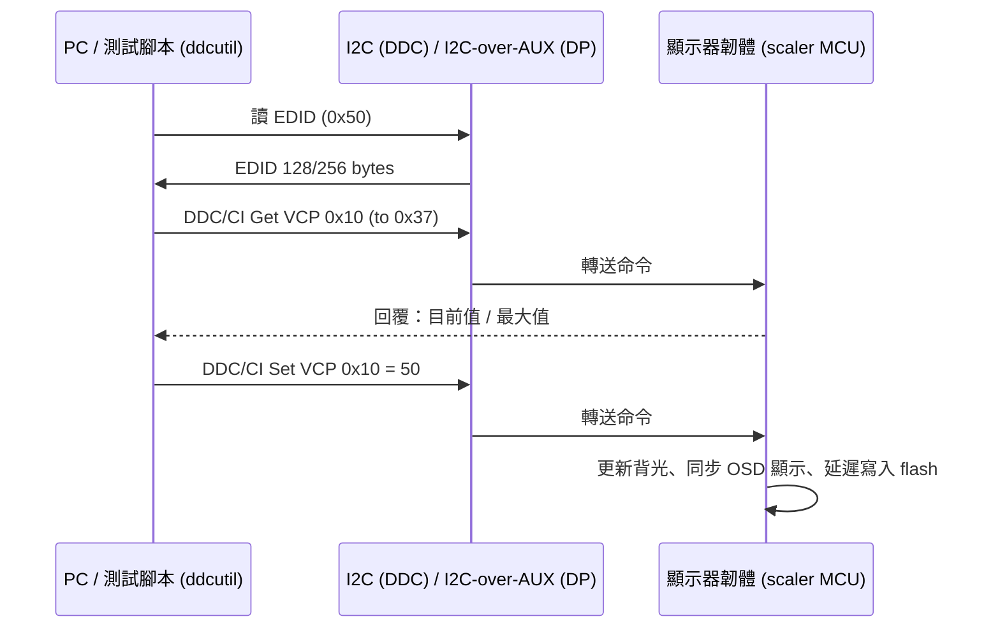

## 為什麼重要
在系統廠做顯示器韌體，你會一直碰到這個需求：「不用按 OSD 按鍵，從電腦就能改亮度、切輸入源、讀韌體版本」。
- **產線**：校正站透過它自動寫入白平衡、切換 pattern。
- **自動化測試**：regression 腳本用它把每個 OSD 選項都跑一遍。
- **客戶軟體**：品牌商的桌面工具（例如調亮度、切 picture mode）、校正軟體（如 Calman 的 hardware calibration）都靠它。
- **認證/相容性**：capabilities string 寫錯，PC 端工具就會誤判功能。

所以，DDC/CI 是新人最值得先學、也最容易動手的主題之一。

## 核心概念
- **DDC（Display Data Channel）**：影像線材裡的一組 I2C 匯流排。主機（PC/GPU）透過它讀取顯示器的 **EDID**（Extended Display Identification Data，顯示器「自我介紹」的資料，通常位於 I2C 位址 0x50）。VGA 的 pin 12/15 就是 DDC 的 SDA/SCL；HDMI 也有 DDC 線；DisplayPort 則透過 **AUX channel** 以 I2C-over-AUX 方式傳送。
- **DDC/CI（DDC Command Interface）**：VESA 定義在 DDC 之上的「雙向命令」協定，讓主機可以「下指令」給顯示器，而不只是讀 EDID。顯示器端的 DDC/CI 位址為 7-bit 0x37（寫入/讀取的 8-bit 位址分別是 0x6E/0x6F）。
- **MCCS（Monitor Control Command Set）**：VESA 定義「有哪些指令」的字典。每個可控制的功能叫 **VCP code**（Virtual Control Panel feature code），例如：
  - `0x10` Brightness（亮度）
  - `0x12` Contrast（對比）
  - `0x14` Select Color Preset（色溫預設；例如 `0x05` = 6500K，但各機種支援值不同）
  - `0x60` Input Source（輸入源）
  - `0xD6` Power Mode（電源模式）
  - `0x02` New Control Value（使用者用 OSD 改過設定的通知旗標）
- **Capabilities string**：顯示器回報自己支援哪些 VCP 與哪些值的字串，例如 `vcp(10 12 14(01 02 04 05) 60(0F 11) ...)`。DDC/CI 1.1 規定顯示器要支援 `vcp()` 字串。
- **Continuous vs Non-Continuous**：亮度這種有範圍（0–最大值）的叫 continuous；色溫預設這種「選項清單」叫 non-continuous。

## 一步一步
以 Linux PC + 一台支援 DDC/CI 的顯示器為例（OSD 裡的「DDC/CI」選項要打開）：

1. 安裝與權限
   ```bash
   sudo apt install ddcutil i2c-tools
   sudo modprobe i2c-dev          # 讓 /dev/i2c-* 出現
   sudo usermod -aG i2c $USER     # 讓一般使用者可讀寫（重新登入後生效）
   ```
2. 找到顯示器
   ```bash
   ddcutil detect
   ```
   會列出每台顯示器對應的 I2C bus、EDID 中的廠牌/型號/序號。
3. 讀 capabilities
   ```bash
   ddcutil --display 1 capabilities
   ```
4. 讀與寫亮度
   ```bash
   ddcutil --display 1 getvcp 10        # 讀亮度：會回目前值與最大值
   ddcutil --display 1 setvcp 10 50     # 設亮度 = 50
   ddcutil --display 1 setvcp 10 + 5    # 相對調整 +5
   ddcutil --display 1 --brief getvcp 10  # 精簡輸出，方便腳本解析
   ```
5. 切色溫預設 / 輸入源（值請以 capabilities 為準）
   ```bash
   ddcutil --display 1 setvcp 14 5      # 0x05 通常是 6500K
   ddcutil --display 1 getvcp 60
   ```
6. 查 VCP 字典
   ```bash
   ddcutil vcpinfo 10 -v
   ```

## 圖解


ASCII 版：
```
 PC(ddcutil) ──I2C/DDC──► [0x50 EDID EEPROM/FW]
      │
      └──────DDC/CI──────► [0x37 Scaler FW] ──► 背光 / PQ / 輸入切換 / OSD 同步
```

## 常見陷阱
- **OSD 裡 DDC/CI 被關掉**：很多機種預設開啟，但某些省電模式或 factory reset 後會關；`ddcutil detect` 看得到 EDID 但 DDC/CI 指令失敗。
- **太快連續下指令**：顯示器 MCU 處理需要時間，DDC/CI 規範有命令間隔要求；ddcutil 內建等待，但自己寫 I2C 腳本時要加延遲與重試。
- **經過 dock / KVM / 轉接器**：中間的 hub 或 MST hub 可能不轉送 DDC/CI。
- **韌體端**：OSD 與 DDC/CI 同時改同一個值的 race condition；DDC/CI 改值後 OSD 畫面沒同步；每次 setvcp 都立刻寫 flash → 磨耗（應延遲寫入）。
- **Capabilities string 與實際不符**：寫了支援的值實際不支援，PC 工具會出錯，是常見客訴來源。

## 動手練習
1. 用 `ddcutil detect` 與 `ddcutil capabilities` 列出你手邊顯示器支援的所有 VCP，並找出 0x14 支援哪些色溫值。
2. 寫一個 bash 或 Python 腳本：把亮度從 0 掃到最大值（每次 +10），每步讀回確認值相同，記錄任何不一致。
3. 進階：在 OSD 手動改亮度後執行 `ddcutil getvcp 02`，觀察 New Control Value 是否被設定（不是所有顯示器都支援）。

## 自我檢測
1. EDID 與 DDC/CI 的 I2C 位址分別是多少？
2. MCCS 中 VCP 0x10、0x60 分別代表什麼？
3. DisplayPort 沒有獨立的 DDC 線，EDID 與 DDC/CI 怎麼傳？
4. 為什麼韌體不應該在每次收到 Set VCP 就立刻寫 flash？
5. Capabilities string 的用途是什麼？

<details><summary>參考答案</summary>

1. EDID 在 0x50；DDC/CI 在 7-bit 0x37（8-bit 寫/讀 0x6E/0x6F）。
2. 0x10 = Brightness；0x60 = Input Source。
3. 透過 AUX channel 以 I2C-over-AUX 傳送。
4. Flash 有寫入次數限制，連續調整會大量寫入；應用 dirty flag + 延遲寫入，並注意斷電保護。
5. 讓主機知道顯示器支援哪些 VCP code 與哪些值，避免下達不支援的指令。
</details>

## 參考資料
- ddcutil 官方文件（指令總覽）：https://www.ddcutil.com/commands/
- ddcutil setvcp：https://www.ddcutil.com/command_setvcp/
- ddcutil vcpinfo 輸出（VCP 定義與 MCCS 版本）：https://www.ddcutil.com/vcpinfo_output/
- ddcutil 安裝與權限設定：https://www.ddcutil.com/config/
- VESA DDC/CI Standard 1.1（非官方鏡像）：https://glenwing.github.io/docs/VESA-DDCCI-1.1.pdf
- VESA E-EDID A2 / EDID 1.4（非官方鏡像）：https://glenwing.github.io/docs/VESA-EEDID-A2.pdf
- VESA 免費標準下載（官方）：https://vesa.org/vesa-standards/
- DDC/CI 封包範例（Hatteland 文件，顯示 0x6E/0x6F 位址）：https://www.hattelandtechnology.com/hubfs/pdf/documentation/ind100064-52_rev01.pdf
- 「命令間隔」的精確毫秒數本文未列出（需查證 DDC/CI 1.1 原文）。
