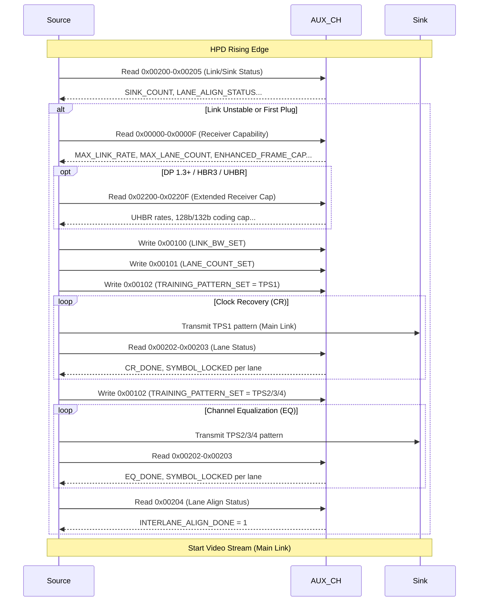

## 為什麼重要

當你把筆電插上 DisplayPort 螢幕，螢幕怎麼知道要用 4K@144Hz 還是 1080p@60Hz？Source（顯示卡）又怎麼決定用幾條 lane、多少 link rate 來傳資料？

答案都在 **DPCD (DisplayPort Configuration Data)** 裡。

DPCD 是 DisplayPort Sink（螢幕端）透過 **AUX channel** 向 Source 宣告「我能做什麼」的暫存器空間。Source 開機偵測到 HPD (Hot Plug Detect) 訊號後，第一件事就是讀 DPCD，根據 Sink 宣告的能力決定 link training 參數。

身為 Monitor FW 工程師，你必須：
- 正確填寫 DPCD 初始值（別虛報能力，否則 link training 會失敗或畫面異常）
- 理解 Source 讀哪些 register、按什麼順序讀
- 帶機時能用 AUX analyzer 或 `ddcutil` 讀出 DPCD 並解釋每個 bit

這篇文章帶你從零認識 DPCD 結構、關鍵 register 與實務除錯重點。

---

## 核心概念

### DPCD 是什麼？

- **全名**：DisplayPort Configuration Data
- **本質**：一個位址空間 0x00000–0xFFFFF 的虛擬記憶體，Sink 端實作
- **存取方式**：透過 **AUX channel**（半雙工、曼徹斯特編碼、1 Mbps）進行 read/write
- **三大功能**：
  1. **Capability 宣告**（Read-only）：Sink 告訴 Source「我支援 HBR2、4 lanes、DSC、FEC...」
  2. **Link 配置**（Write-only by Source）：Source 寫入「我們用 HBR2、4 lanes、Enhanced framing」
  3. **Status 回報**（Read-only）：Link training 過程中 Sink 回報「CR done、EQ done、Symbol lock、Lane align」

> 💡 **關鍵觀念**：DPCD ≠ EDID。EDID 描述「支援的影像格式、色域、白點」，DPCD 描述「傳輸鏈路能力、執行中狀態」。兩者互補，缺一不可。

### DPCD 位址空間大圖

```
0x00000–0x0000F  Receiver Capability Field (16 bytes)  ← Source 讀這裡決定如何 training
0x00010–0x000FF  Reserved / Vendor-specific
0x00100–0x001FF  Link Configuration Field              ← Source 寫這裡設定 link
0x00200–0x0020F  Link / Sink Status Field              ← Source 讀這裡看 training 結果
0x00210–0x005FF  MST / Branch / HDCP 等
0x00600–0x006FF  Sink Control Field (Power state)
0x02200–0x0220F  Extended Receiver Capability (DP 1.3+) ← HBR3/UHBR 必須實作
0x00060–0x0006F  DSC Receiver Capabilities (DP 1.4+)
0x00090–0x0009F  FEC Capability/Config/Status (DP 1.4+)
0xF0000–0xF0FFF  LTTPR Registers (DP 1.4a+)
```

---

## 一步一步：Source 讀取 DPCD 的標準流程

根據 VESA DP 規格，Source 在偵測到 HPD rising edge 後，**必須**依序執行：

### 步驟 1：讀 Link/Sink Status (0x00200–0x00205)
確認 link 是否穩定。若 `SINK_COUNT` (0x00200) 顯示有裝置且 `LANE_ALIGN_STATUS_UPDATED` (0x00204) 顯示 aligned，可直接開始傳影像。

### 步驟 2：若 link 不穩定 → 讀 Receiver Capability (0x00000–0x0000F)
**這 16 bytes 是核心**。Source 根據這裡的 `MAX_LINK_RATE`、`MAX_LANE_COUNT`、`ENHANCED_FRAME_CAP` 等決定 training 參數。

> ⚠️ **實務坑點**：DP 2.1 CTS 要求 Source **必須讀完 16 bytes (含 0x0000F ADAPTER_CAP)** 才能開始 training。Linux kernel 曾因只讀 15 bytes 導致 CTS 失敗（參見 freedesktop.org review）。

### 步驟 3：若支援 DP 1.3+ → 讀 Extended Receiver Capability (0x02200–0x0220F)
HBR3 (8.1 Gbps) 或 UHBR (10/13.5/20 Gbps) 必須在此宣告。結構與 0x00000 對應，但 `MAX_LINK_RATE` 可宣告更高速率，`MAIN_LINK_CHANNEL_CODING_CAP` Bit 1 宣告 128b/132b 編碼支援。

### 步驟 4：Source 寫 Link Configuration (0x00100–0x00102)
- `LINK_BW_SET` (0x00100)：設定 link rate
- `LANE_COUNT_SET` (0x00101)：設定 lane count + Enhanced framing enable
- `TRAINING_PATTERN_SET` (0x00102)：設定 training pattern (TPS1/2/3/4)

### 步驟 5：執行 Link Training (CR → EQ → Symbol Lock → Inter-lane Alignment)
執行過程中 Source 反覆讀 `LANE0_1_STATUS` (0x00202)、`LANE2_3_STATUS` (0x00203)、`LANE_ALIGN_STATUS_UPDATED` (0x00204) 判斷每階段是否通過。

### 步驟 6：Training 成功 → 開始傳送影像資料 (Main Link)

---

## 圖解：DPCD 讀寫時序與 Link Training 流程



---

## 關鍵 Register 詳細解析

### 1. Receiver Capability Field (0x00000–0x0000F) — 必讀 16 Bytes

| Offset | Register | 關鍵 Bits | 範例值 | 說明 |
|--------|----------|-----------|--------|------|
| 00h | **DPCD_REV** | 7:4 Major, 3:0 Minor | 14h | DP 1.4 = 14h。不一定等於 DP 版本號 |
| 01h | **MAX_LINK_RATE** | 7:0 = value × 0.27 Gbps | 14h | 14h × 0.27 = 5.4 Gbps (HBR2) |
| 02h | **MAX_LANE_COUNT** | 4:0 = lanes (1/2/4)<br>7 = ENHANCED_FRAME_CAP<br>6 = TPS3_SUPPORTED | C2h | 4 lanes + Enhanced framing + TPS3 |
| 03h | **MAX_DOWNSPREAD** | 0 = down-spread 支援<br>7 = TPS4_SUPPORTED | 01h | 支援 0.5% down-spread |
| 04h | **NORP / DP_PWR** | 3:0 = NORP<br>7:5 = voltage cap | 01h | NORP=1 (常見) |
| 05h | **DOWN_STREAM_PORT_PRESENT** | 0 = 有下游 port<br>4 = 詳細能力資訊可用 | 00h | 一般 monitor = 0 (無 MST hub) |
| 06h | **MAIN_LINK_CHANNEL_CODING_CAP** | 0 = 8b/10b<br>1 = 128b/132b (UHBR) | 01h / 03h | DP 1.4=01h, DP 2.1 UHBR=03h |
| 07h | **DOWN_STREAM_PORT_COUNT** | 3:0 = port count<br>7 = OUI 支援 | 01h / 81h | 一般 monitor = 1 |
| 08h–09h | **RECEIVE_PORT0_CAP** | Buffer size, H-blank, Local EDID | 02h 01h | Port 0 = primary stream |
| 0Ah–0Bh | **RECEIVE_PORT1_CAP** | 同結構 | 04h 01h | Port 1 = secondary (MST 用) |
| 0Ch | **I2C_SPEED_CONTROL_CAP** | 支援 I²C 速率 bitmap | 0Fh | 1K/5K/10K/100K |
| 0Dh | **EDP_CONFIGURATION_CAP** | eDP 專用 | 00h | 非 eDP 通常 = 0 |
| 0Eh | **TRAINING_AUX_RD_INTERVAL** | 7 = EXTENDED_CAP_PRESENT<br>6:0 = CR/EQ AUX interval | 81h | Extended caps 存在 + 間隔設定 |
| 0Fh | **ADAPTER_CAP** | 0 = DP++ (dual-mode) 支援 | 00h/01h | **USB-C DP Alt Mode 必須 = 0** |

> 🔑 **MAX_LINK_RATE 編碼對照表**：
> - 06h = RBR (1.62 Gbps/lane)
> - 0Ah = HBR (2.7 Gbps/lane)
> - 14h = HBR2 (5.4 Gbps/lane)
> - 1Eh = HBR3 (8.1 Gbps/lane)
> - UHBR10/13.5/20 編碼值需查閱 DP 2.1 spec（公開版未完整列出，**需查證**）

### 2. Extended Receiver Capability (0x02200–0x0220F) — HBR3/UHBR 必須

結構同 0x00000，但：
- 0x02201h `MAX_LINK_RATE`：可宣告 1Eh (HBR3) 或 UHBR 速率
- 0x02206h `MAIN_LINK_CHANNEL_CODING_CAP` Bit 1 = 1 表示支援 128b/132b (UHBR 必須)
- 0x0220Eh Bit 7 = 1 宣告 extended caps 存在

### 3. Link Configuration (Source 寫入)

| Address | Register | 範例值 | 說明 |
|---------|----------|--------|------|
| 00100h | LINK_BW_SET | 14h | 設為 HBR2 (5.4 Gbps) |
| 00101h | LANE_COUNT_SET | 84h | Bit 7=1 (Enhanced framing) + 4 lanes |
| 00102h | TRAINING_PATTERN_SET | 01h/02h/03h/04h | TPS1/2/3/4；Bit 7 = scrambling disable |

### 4. Link/Sink Status (Source 讀取，Training 核心)

| Address | Register | 關鍵 Bits |
|---------|----------|-----------|
| 00200h | SINK_COUNT | Bit 7 = CP_READY；Bits 6:0 = sink count |
| 00202h | LANE0_1_STATUS | Lane 0: Bit 7=CR_DONE, Bit 6=EQ_DONE, Bit 5=SYMBOL_LOCKED<br>Lane 1: Bit 3=CR_DONE, Bit 2=EQ_DONE, Bit 1=SYMBOL_LOCKED |
| 00203h | LANE2_3_STATUS | 同上，Lane 2/3 |
| 00204h | LANE_ALIGN_STATUS_UPDATED | Bit 0 = INTERLANE_ALIGN_DONE (全部 lane align 完成) |
| 00205h | SINK_STATUS | Bit 0 = Port 0 接收狀態；Bit 1 = Port 1 接收狀態 |

---

## 常見陷阱

| 陷阱 | 症狀 | 原因 | 解法 |
|------|------|------|------|
| **ADAPTER_CAP (0x0000F) 未實作或錯誤** | Source 讀完 0x00000–0x0000E 就停住，不執行 training | DP 2.1 CTS 要求讀完 16 bytes 含 0x0000F | 確實實作 0x0000F，USB-C 端口 Bit 0=0 |
| **MAX_LINK_RATE 虛報** | Link training 一直 fallback 到 RBR，或根本無法 training | 面板/TCON/SerDes 不支援該速率，但 DPCD 宣告支援 | 依硬體實測上限填寫，寧保守勿激進 |
| **ENHANCED_FRAME_CAP = 0** | DP 1.2+ Source 拒絕 training 或 fallback | DP 1.2 規定 Sink 必須支援 Enhanced framing | 永遠置 1 (0x00002h Bit 7 = 1) |
| **DOWN_STREAM_PORT_PRESENT = 1 但無實際 port** | MST hub 或型轉換器偵測異常、EDID 讀取失敗 | Sink 錯誤宣告有下游 port | 純 monitor 端口 = 0；只有 branch device 才置 1 |
| **128b/132b CAP (0x02206h Bit 1) 未置 1** | UHBR link training 直接失敗、Source 不嘗試 UHBR | Sink 未宣告支援 128b/132b 編碼 | DP 2.1 UHBR 產品必須置 1 |
| **FEC/DSC capability 宣告與 HW 不符** | CTS 失敗、或啟用後畫面異常、error count 暴增 | FW 表填錯、或 scaler HW 實際不支援該模式 | 對照 scaler datasheet 逐項核對，用 AUX analyzer 實測驗證 |

---

## 動手練習

### 練習 1：用 `ddcutil` 讀取自家螢幕的 DPCD (需 Linux + i2c-dev)

```bash
# 1. 偵測所有 DDC/CI 裝置
sudo ddcutil detect

# 2. 讀取 DPCD 0x00000-0x0000F (前 16 bytes)
# 注意：ddcutil 透過 I2C 存取 DPCD，需確認 kernel 支援 drm_dp_aux_dev
sudo ddcutil --bus=N vcp-gcp 0x00 0x00 16  # 語法視版本而異，參考 man page

# 3. 或用 i2ctools 直接讀 (需知道 I2C bus number 和 address 0x6C/0x6E 等)
sudo i2cdump -y N 0x6C b  # 某些平台 DPCD 在 0x6C
```

> 💡 更簡單的方式：用 **Unigraf UCD-400 / Teledyne LeCroy AUX analyzer** 擷取 AUX transaction，或在 FW 端加入 UART 指令 `dpcd_dump` 印出完整 register map。

### 練習 2：解析一組實際 DPCD Dump

以下是某 4K@144Hz DP 1.4 螢幕的 Receiver Capability dump（十六進位）：

```
00000: 14 14 C2 01 01 00 01 81 02 01 00 00 0F 00 81 00
```

請嘗試手動解析（參考上表）：

<details>
<summary>點擊展開答案</summary>

| Offset | 值 | 解析 |
|--------|-----|------|
| 00h | 14h | DPCD Rev 1.4 |
| 01h | 14h | MAX_LINK_RATE = 5.4 Gbps (HBR2) |
| 02h | C2h | Bit 7=1 (Enhanced framing)、Bit 6=1 (TPS3)、Bits 4:0=2 (2 lanes? 實際應為 4=4h，**這裡 C2h = 1100 0010b，Bits 4:0=2h 表示 2 lanes，需查證實際產品是否為 2-lane 設計**) |
| 03h | 01h | Down-spread 支援、TPS4 不支援 |
| 04h | 01h | NORP=1 |
| 05h | 00h | 無下游 port |
| 06h | 01h | 僅 8b/10b (DP 1.4) |
| 07h | 81h | 1 port + OUI 支援 |
| 08h–09h | 02h 01h | Port 0: buffer size 64、local EDID present |
| 0Ah–0Bh | 00h 00h | Port 1: 未使用 |
| 0Ch | 0Fh | I²C 1K/5K/10K/100K 支援 |
| 0Dh | 00h | 非 eDP |
| 0Eh | 81h | Extended caps 存在 + AUX read interval |
| 0Fh | 00h | 無 DP++ (USB-C 或純 DP 無 dual-mode) |

**關鍵觀察**：這台螢幕宣告 2 lanes (0x02h) 而非 4 lanes，可能是成本考量或面板介面限制。HBR2 × 2 lanes = 10.8 Gbps 有效頻寬，支援 4K@144Hz 需 DSC 壓縮（DSC capability 在 0x00060h 另行宣告）。
</details>

### 練習 3：在 FW 加入 DPCD Dump 指令

```c
// 範例：透過 UART CLI 印出 DPCD 0x00000-0x000FF
void cmd_dpcd_dump(void) {
    uint8_t buf[256];
    printf("DPCD Receiver Capability (0x00000-0x0000F):\n");
    aux_read(DPCD_RECEIVER_CAP_BASE, 16, buf);
    for (int i = 0; i < 16; i++) printf("0x%02X ", buf[i]);
    printf("\n");
    
    printf("DPCD Link Config (0x00100-0x00102):\n");
    aux_read(0x00100, 3, buf);
    for (int i = 0; i < 3; i++) printf("0x%02X ", buf[i]);
    printf("\n");
    
    printf("DPCD Link Status (0x00200-0x00205):\n");
    aux_read(0x00200, 6, buf);
    for (int i = 0; i < 6; i++) printf("0x%02X ", buf[i]);
    printf("\n");
}
```

帶機時輸入 `dpcd_dump` 即可即時看 Source 寫了什麼、Sink 回報什麼狀態。

---

## 自我檢測

### Q1: DPCD 和 EDID 最大的差別是什麼？
<details>
<summary>答案</summary>
EDID 描述「影像格式能力」（解析度、刷新率、色域、白點），透過 DDC (I2C) 讀取；DPCD 描述「傳輸鏈路能力與狀態」（link rate、lane count、training 狀態、FEC/DSC/LTTPR），透過 AUX channel 讀寫。Source 先讀 EDID 知道「要傳什麼影像」，再讀 DPCD 知道「怎麼傳」。
</details>

### Q2: DP 2.1 CTS 要求 Source 在 link training 前必須讀取 Receiver Capability 幾個 bytes？為什麼？
<details>
<summary>答案</summary>
**16 bytes (0x00000–0x0000F)**。包含 0x0000F `ADAPTER_CAP`。Linux kernel 曾因只讀 15 bytes 導致 CTS 4.2.2.1/4.2.2.2 失敗。規格明訂 Source shall read DPCD Receiver Capability field (00000h through 0000Fh) before link training。
</details>

### Q3: USB-C DP Alt Mode 的螢幕，ADAPTER_CAP (0x0000F) Bit 0 應設為 0 還是 1？為什麼？
<details>
<summary>答案</summary>
**0**。DP++ (Dual-Mode) 只存在於原生 DP connector（需靠 passive adapter 轉 HDMI/DVI）。USB-C DP Alt Mode **明確不支援 DP++**，passive DP→HDMI 轉接頭在 USB-C 後面不會動作，必須用 active converter。VESA DP Alt Mode spec 規定。
</details>

### Q4: 什麼時候必須實作 Extended Receiver Capability (0x02200–0x0220F)？
<details>
<summary>答案</summary>
支援 **HBR3 (8.1 Gbps) 或任何 UHBR (10/13.5/20 Gbps)** 時必須實作。0x00001h `MAX_LINK_RATE` 最大只能宣告到 HBR2 (5.4 Gbps)，更高速率需在 0x02201h 宣告。同時 0x02206h Bit 1 必須 = 1 宣告 128b/132b 編碼支援。
</details>

### Q5: Link training 過程中，Source 如何知道 Channel Equalization (EQ) 階段完成？
<details>
<summary>答案</summary>
Source 反覆讀取 `LANE0_1_STATUS` (0x00202h) 和 `LANE2_3_STATUS` (0x00203h)，檢查每條 lane 的 **EQ_DONE bit**（Lane 0: Bit 6, Lane 1: Bit 2, Lane 2: Bit 6, Lane 3: Bit 2）皆為 1，且 `SYMBOL_LOCKED` 也為 1，即表示 EQ 完成。
</details>

---

## 參考資料

1. **VESA DisplayPort Standard v1.2/v1.4** — Section 2.5.3.1 Address Mapping for DPCD (公開檢視)：https://yumpu.com/en/document/view/31317151/displayporttm-standard-vesa-displayport-standard-home/121
2. **Linux DRM Kernel** — `DP_RECEIVER_CAP_SIZE` 修正討論 (16 bytes 含 ADAPTER_CAP)：https://lore.gitlab.freedesktop.org/drm-ai-reviews/review-overall-20250702223903.3801654-1-khaled.almahallawy@intel.com/t
3. **dpcd_parser** (GitHub) — 開源 DPCD 解析工具與實際 dump 範例：https://github.com/atseanpaul/dpcd_parser
4. **Unigraf** — "Forward Error Correction and Display Stream Compression" 白皮書 (FEC/DSC DPCD map)：https://unigraf.fi/app/uploads/2020/02/Forward-error-correction-and-display-stream-correction.pdf
5. **Granite River Labs** — "Specification and Test Overview of DisplayPort 2.1" (UHBR/FEC/DSC 強制要求)：https://graniteriverlabs.com/en-us/technical-blog/displayport-dp-2-1-overview
6. **VESA Taipei Workshop Oct 2025** — UHBR/FEC/Panel Replay 概覽：https://vesa.org/wp-content/uploads/2025/10/VESA-Taipei-Workshop_Oct-2025.pdf
7. **Club-3D** — DPCD dump 實例 (含 Extended Receiver Capability)：https://insights.club-3d.com/thread/dp-2-1-to-hdmi-2-1-adapter
8. **AMD DP Subsystem Product Guides** (PG233/PG299/PG300) — 公開文件中的 DPCD register 對照：https://docs.amd.com
9. **TI Application Report SDAA295** — "Debugging Methodology for DisplayPort/eDP Link Training"：https://www.ti.com/lit/pdf/sdaa295
10. **lungtenghsu 技術部落格** — "DP Aux 的二三事 - 其二 - DPCD" 詳細 register 表：https://lungtenghsu.blogspot.com/2026/08/dp-aux-dpcd.html (部分需查證)

---

> 📌 **提醒**：VESA DP 完整規格書需要會員身分或 NDA 才能取得。本文所有數字皆來自公開文件、開源驅動程式碼、晶片廠公開 Product Guide 或技術部落客整理。實際專案開發時，**請以手邊最新 SDK 提供的 DPCD 初始化表為準**，並用 AUX analyzer 實測驗證。
