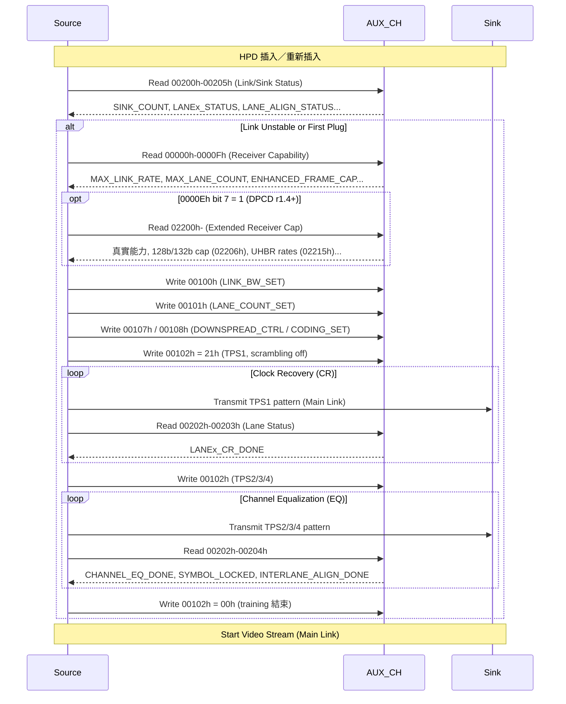

## 為什麼重要

當你把筆電插上 DisplayPort 螢幕，螢幕怎麼知道要用 4K@144Hz 還是 1080p@60Hz？Source（顯示卡）又怎麼決定用幾條 lane、多少 link rate 來傳資料？

傳輸鏈路那一半的答案在 **DPCD（DisplayPort Configuration Data）** 裡；要傳什麼影像格式，則看 EDID／DisplayID。

DPCD 是 DisplayPort 接收端（DPRX）透過 **AUX channel** 讓 Source 讀寫的暫存器空間，Sink 用它宣告「我能做什麼」。Source 偵測到 HPD（Hot Plug Detect）的插入事件後，會先讀 Link/Sink 狀態，鏈路不穩或新插入時再讀 Receiver Capability，接著做 link training（VESA DP 2.0 PDF p.992）。

身為 Monitor FW 工程師，你必須：
- 正確填寫 DPCD 初始值（別虛報能力，否則 link training 會失敗或畫面異常）
- 理解 Source 讀哪些 register、按什麼順序讀
- 帶機時能用 AUX analyzer 或作業系統提供的 AUX 介面讀出 DPCD，並解釋每個 bit

這篇文章帶你從零認識 DPCD 結構、關鍵 register 與實務除錯重點。

> 規格依據：本文暫存器位址與 bit 定義以 VESA DisplayPort Standard 2.0（2019-06-26）核對，頁碼為 PDF 頁序。DP 2.1 新增欄位本文未涵蓋。

---

## 核心概念

### DPCD 是什麼？

- **全名**：DisplayPort Configuration Data
- **本質**：位址範圍 00000h–FFFFFh 的位元組定址空間，由接收端實作（VESA DP 2.0 PDF p.425）
- **存取方式**：透過 **AUX channel**（半雙工、Manchester-II 編碼、1Mbps；單筆傳輸最多 16 bytes）進行 read/write（VESA DP 2.0 PDF p.81）
- **三大功能**：
  1. **Capability 宣告**（唯讀）：Sink 告訴 Source「我支援 HBR2、4 lanes、DSC、FEC……」
  2. **Link 配置**（Source 寫入，也可讀回）：Source 寫入「我們用 HBR2、4 lanes、Enhanced framing」
  3. **Status 回報**（大多唯讀）：Link training 過程中 Sink 回報 CR done、EQ done、Symbol lock、Interlane align

> **關鍵觀念**：DPCD ≠ EDID。EDID 描述「支援的影像格式、色域、白點」，DPCD 描述「傳輸鏈路能力、執行中狀態」。兩者互補，缺一不可。

### DPCD 位址空間大圖

以下依 VESA DP 2.0 Table 2-182（PDF p.425）整理，只列 sink FW 最常碰到的區塊：

```
00000h–000FFh  Receiver Capability          ← 含 00000h–0000Fh 基本能力、00060h–0006Fh DSC、00090h FEC
00100h–001FFh  Link Configuration           ← Source 寫這裡設定 link
00200h–002FFh  Link/Sink Device Status      ← Source 讀這裡看 training 結果
00300h–003FFh  Source Device-specific
00400h–004FFh  Sink Device-specific         ← Sink 的 IEEE OUI 等
00500h–005FFh  Branch Device-specific
00600h–006FFh  Link/Sink Device Power Control
02000h–021FFh  DPRX Event Status Indicator (ESI)
02200h–022FFh  Extended Receiver Capability ← DPCD r1.4 起必備
68000h–69FFFh  HDCP 1.3 / HDCP 2.2
F0000h–F02FFh  LTTPR                        ← DPCD r1.4 起有效
```

- DSC 能力（00060h–0006Fh）適用 DP 1.4 以上（VESA DP 2.0 PDF p.446）；FEC 能力 00090h–00091h 為 DP 1.4 新增（VESA DP 2.0 PDF p.459）。兩者都在 Receiver Capability 區塊內，不是獨立區塊。
- LTTPR 暫存器 F0000h–F02FFh 只對 DPCD r1.4 以上有效（VESA DP 2.0 PDF p.574）。

---

## 一步一步：Source 讀取 DPCD 的流程

依 VESA DP 2.0 第 5.1.4 節（PDF p.991–992）與第 3.5.1.2 節（PDF p.733）整理：

### 步驟 1：讀 Link/Sink Status（00200h–00205h，或 ESI 的 02002h–0200Fh）
插入或重新插入時，Source 先讀這段確認鏈路狀態。若鏈路仍穩定（各 lane 鎖定、`INTERLANE_ALIGN_DONE` 為 1），不一定要重新 training。若收到的是 IRQ_HPD 短脈衝，Source 必須在 HPD 上升緣後 100ms 內開始讀這段（VESA DP 2.0 PDF p.991–992）。

### 步驟 2：鏈路不穩或遺失 → 讀 Receiver Capability（00000h–0000Fh）
**這 16 bytes 是核心**。規格內文寫的是讀 00000h–0000Fh；同節的 HPD 事件圖則寫 00000h–0000Bh，兩處範圍不一致，實作上直接讀滿 16 bytes 最保險（VESA DP 2.0 PDF p.991–992）。Source 根據 `MAX_LINK_RATE`、`MAX_LANE_COUNT`、`ENHANCED_FRAME_CAP` 等決定 training 參數。

> **實務坑點（待查證）**：網路上有討論指出 Linux kernel 曾只讀 15 bytes 而碰到 CTS 問題（見參考資料 2）。DP CTS 文件不在手邊的規格庫，CTS 條款編號與要求細節待查證。

### 步驟 3：DPCD r1.4 以上 → 讀 Extended Receiver Capability（02200h 起）
- 0000Eh bit 7（`EXTENDED_RECEIVER_CAPABILITY_FIELD_PRESENT`）為 1，表示 02200h–022FFh 有內容；DPCD r1.4 以上的接收端必須提供這個區塊（VESA DP 2.0 PDF p.438）。
- 02200h–0220Fh 與 00000h–0000Fh 結構相同，只有 `DPCD_REV`、`MAX_LINK_RATE`、`DOWN_STREAM_PORT_PRESENT` 三個值可以不同：延伸區塊要寫真實能力，基本區塊可以為了相容舊 Source 而保守填寫（例如報 HBR、DPCD r1.1）（VESA DP 2.0 PDF p.426）。
- 02201h 仍然只描述 8b/10b 的速率（最高 1Eh＝HBR3）。UHBR 速率不在這裡，而是看 02215h `128b/132b_SUPPORTED_LINK_RATES`：bit 0＝UHBR10、bit 1＝UHBR20、bit 2＝UHBR13.5；支援 128b/132b 的裝置必須支援 UHBR10（VESA DP 2.0 PDF p.529、p.541）。
- 02206h bit 1（`128b/132b_SUPPORTED`）為 1，才表示支援 128b/132b（VESA DP 2.0 PDF p.434、p.541）。

### 步驟 4：Source 寫 Link Configuration
規格列出的寫入項目是 `LINK_BW_SET`（00100h）、`LANE_COUNT_SET`（00101h bits 4:0）、`DOWNSPREAD_CTRL`（00107h）、`MAIN_LINK_CHANNEL_CODING_SET`（00108h），寫完後再寫 `TRAINING_PATTERN_SET`（00102h）開始 training；8b/10b 的範例是寫 21h，也就是 TPS1 加上關閉 scrambling（VESA DP 2.0 PDF p.733）。

### 步驟 5：執行 Link Training（兩個階段）
規格把 8b/10b link training 分成兩段：先做 Clock Recovery（`LANEx_CR_DONE`），再做 Channel Equalization；第二段結束時要同時達成 `LANEx_CHANNEL_EQ_DONE`、`LANEx_SYMBOL_LOCKED` 與 `INTERLANE_ALIGN_DONE`（VESA DP 2.0 PDF p.733）。過程中 Source 反覆讀 `LANE0_1_STATUS`（00202h）、`LANE2_3_STATUS`（00203h）、`LANE_ALIGN_STATUS_UPDATED`（00204h）。讀取間隔看 `TRAINING_AUX_RD_INTERVAL`（0000Eh／0220Eh）。

### 步驟 6：Training 成功 → 把 00102h 寫回 00h，開始傳送影像
規格要求 Source 在 training 完成時把 `TRAINING_PATTERN_SET` 寫回 00h（VESA DP 2.0 PDF p.469）。

---

## 圖解：DPCD 讀寫時序與 Link Training 流程（8b/10b）



---

## 關鍵 Register 詳細解析

### 1. Receiver Capability Field（00000h–0000Fh）：必讀 16 Bytes

依 VESA DP 2.0 Table 2-183（PDF p.427–438）核對：

| Offset | Register | 關鍵 Bits | 範例值 | 說明 |
|--------|----------|-----------|--------|------|
| 00h | **DPCD_REV** | 7:4 Major, 3:0 Minor | 14h | 14h＝DPCD r1.4；DPCD 版本不一定等於 DP 版本（p.427） |
| 01h | **MAX_LINK_RATE**（DP 2.0 稱 8b/10b_MAX_LINK_RATE） | 7:0＝值 × 0.27 Gbps/lane | 14h | 14h × 0.27 = 5.4 Gbps/lane（HBR2）；只描述 8b/10b（p.427） |
| 02h | **MAX_LANE_COUNT** | 4:0＝lanes（1/2/4）<br>5＝POST_LT_ADJ_REQ_SUPPORTED<br>6＝TPS3_SUPPORTED<br>7＝ENHANCED_FRAME_CAP | C4h | 4 lanes + TPS3 + Enhanced framing（p.428–429） |
| 03h | **MAX_DOWNSPREAD** | 0＝最多 0.5% down-spread（SSC）<br>1＝STREAM_REGENERATION_STATUS_CAPABILITY（DP 2.0 新增）<br>6＝NO_AUX_TRANSACTION_LINK_TRAINING<br>7＝TPS4_SUPPORTED | 01h | DPCD r1.1 以上 bit 0 必須為 1（p.430） |
| 04h | **NORP & DP_PWR_VOLTAGE_CAP** | 0＝NORP（接收埠數＝值 + 1）<br>1＝CRC_3D_OPTIONS_SUPPORTED<br>7:5＝5V／12V／18V DP_PWR 能力 | 01h | NORP bit＝1 表示兩個接收埠（SST 時通常是影像 + 對應音訊）（p.431–432） |
| 05h | **DOWN_STREAM_PORT_PRESENT** | 0＝DFP_PRESENT（Branch 才有）<br>2:1＝DFP 類型<br>3＝FORMAT_CONVERSION<br>4＝DETAILED_CAP_INFO_AVAILABLE | 00h | 一般 monitor（非 Branch）＝0（p.433） |
| 06h | **MAIN_LINK_CHANNEL_CODING_CAP** | 0＝8b/10b（必須為 1）<br>1＝128b/132b | 01h / 03h | 只支援 8b/10b＝01h；支援 128b/132b＝03h（p.434） |
| 07h | **DOWN_STREAM_PORT_COUNT** | 3:0＝DFP 數量<br>6＝MSA_TIMING_PAR_IGNORED<br>7＝OUI 支援 | 80h | 沒有下游埠的 monitor，DFP 數＝0；DPCD r1.2／r1.4 必須支援 OUI（p.434） |
| 08h | **RECEIVE_PORT0_CAP_0** | 1＝LOCAL_EDID_PRESENT<br>2＝ASSOCIATED_TO_PRECEDING_PORT（Port 0 必為 0）<br>3＝HBLANK_EXPANSION_CAPABLE<br>4＝BUFFER_SIZE_UNIT<br>5＝BUFFER_SIZE_PER_PORT | 02h | Sink 必須有本地 EDID／DisplayID（p.435） |
| 09h | **RECEIVE_PORT0_CAP_1** | 7:0＝BUFFER_SIZE，大小＝（值 + 1）× 32 | 01h | 單位（pixel 或 byte、每 lane 或每 port）看 08h bit 4/5（p.436） |
| 0Ah–0Bh | **RECEIVE_PORT1_CAP_0/1** | 同 Port 0 結構 | 04h 01h | Port 1 不存在時讀到 0；MST 模式不用這兩個暫存器（p.436–437） |
| 0Ch | **I2C Speed Control Capabilities** | bitmap：01h＝1K、02h＝5K、04h＝10K、08h＝100K、10h＝400K、20h＝1Mbps | 0Fh | 沒有實體 I²C bus 時填 00h（p.437） |
| 0Dh | **eDP_CONFIGURATION_CAP** | eDP 專用 | 00h | 外接接收端一律讀 00h（p.437） |
| 0Eh | **TRAINING_AUX_RD_INTERVAL**（DP 2.0 稱 8b/10b_TRAINING_AUX_RD_INTERVAL） | 6:0＝讀取間隔代碼<br>7＝EXTENDED_RECEIVER_CAPABILITY_FIELD_PRESENT | 81h | 00h：CR 100us／EQ 400us；01h–04h：CR 100us／EQ 4–16ms（p.438） |
| 0Fh | **ADAPTER_CAP** | 0＝FORCE_LOAD_SENSE_CAP（VGA 強制負載偵測）<br>1＝ALTERNATE_I2C_PATTERN_CAP | 00h | 給轉接到舊式介面的 Branch 用，一般 monitor 填 00h（p.438） |

> **MAX_LINK_RATE 編碼對照表**（VESA DP 2.0 PDF p.427）：
> - 06h＝RBR（1.62 Gbps/lane）
> - 0Ah＝HBR（2.7 Gbps/lane）
> - 14h＝HBR2（5.4 Gbps/lane）
> - 1Eh＝HBR3（8.1 Gbps/lane）
> - UHBR 不用這個暫存器宣告，看 02215h 的 bitmap（見下節）。Source 設定 UHBR 時，`LINK_BW_SET` 在 128b/132b 模式下的值是 01h＝UHBR10、02h＝UHBR20、04h＝UHBR13.5（VESA DP 2.0 PDF p.467）。

### 2. Extended Receiver Capability（02200h–022FFh）：DPCD r1.4 起必備

- 02200h–0220Fh 結構同 00000h–0000Fh，但只有 `DPCD_REV`、`MAX_LINK_RATE`、`DOWN_STREAM_PORT_PRESENT` 可以和基本區塊不同；基本區塊的 `DPCD_REV` 不可高於 02200h（VESA DP 2.0 PDF p.426）
- 02201h `8b/10b_MAX_LINK_RATE`：寫真實的 8b/10b 上限，例如 1Eh（HBR3）（VESA DP 2.0 PDF p.529）
- 02206h `MAIN_LINK_CHANNEL_CODING_CAP` bit 1＝1 表示支援 128b/132b
- 02215h `128b/132b_SUPPORTED_LINK_RATES`：bit 0 UHBR10（128b/132b 裝置必備）、bit 1 UHBR20、bit 2 UHBR13.5（VESA DP 2.0 PDF p.541）
- 宣告「延伸區塊存在」的是 0000Eh bit 7；0220Eh bit 7 是對應的鏡像欄位（VESA DP 2.0 PDF p.426、p.538）

### 3. Link Configuration（Source 寫入）

| Address | Register | 範例值 | 說明 |
|---------|----------|--------|------|
| 00100h | LINK_BW_SET | 14h | 8b/10b 下設為 HBR2（5.4 Gbps/lane）（p.467） |
| 00101h | LANE_COUNT_SET | 84h | bit 7＝ENHANCED_FRAME_EN、bits 4:0＝4 lanes；bit 5＝POST_LT_ADJ_REQ_GRANTED（p.468） |
| 00102h | TRAINING_PATTERN_SET | 01h／02h／03h／07h | 8b/10b 下 bits 3:0：1h＝TPS1、2h＝TPS2、3h＝TPS3、**7h＝TPS4**；**bit 5＝SCRAMBLING_DISABLE**（p.470–471） |

### 4. Link/Sink Status（Source 讀取，Training 核心）

| Address | Register | 關鍵 Bits |
|---------|----------|-----------|
| 00200h | SINK_COUNT | **bit 6＝CP_READY**；bits 7 與 5:0 合起來是 sink count（p.488） |
| 00202h | LANE0_1_STATUS | Lane 0：bit 0＝CR_DONE、bit 1＝CHANNEL_EQ_DONE、bit 2＝SYMBOL_LOCKED<br>Lane 1：bit 4＝CR_DONE、bit 5＝CHANNEL_EQ_DONE、bit 6＝SYMBOL_LOCKED（p.490） |
| 00203h | LANE2_3_STATUS | 同上，Lane 2（bits 2:0）／Lane 3（bits 6:4）（p.490） |
| 00204h | LANE_ALIGN_STATUS_UPDATED | bit 0＝INTERLANE_ALIGN_DONE；bit 1＝POST_LT_ADJ_REQ_IN_PROGRESS；bit 6＝DOWNSTREAM_PORT_STATUS_CHANGED；bit 7＝LINK_STATUS_UPDATED（p.490） |
| 00205h | SINK_STATUS | bit 0＝Port 0 同步狀態；bit 1＝Port 1 同步狀態；bit 2＝STREAM_REGENERATION_STATUS（DP 2.0 新增）（p.491） |

00200h–00205h 在 ESI 區（02002h–0200Fh）有對應的鏡像暫存器（VESA DP 2.0 PDF p.488）。

---

## 常見陷阱

| 陷阱 | 症狀 | 原因 | 解法 |
|------|------|------|------|
| **基本區塊與延伸區塊不一致** | 新 Source 正常、舊 Source 不亮或亂 fallback（待查證：實際症狀依 Source 而異） | 只有 `DPCD_REV`、`MAX_LINK_RATE`、`DOWN_STREAM_PORT_PRESENT` 允許不同，其他欄位填得不一樣 | 02200h–0220Fh 其餘欄位與 00000h–0000Fh 保持一致；`DPCD_REV` 基本區塊不可高於延伸區塊（VESA DP 2.0 PDF p.426） |
| **MAX_LINK_RATE 虛報** | Link training 一直 fallback 到 RBR，或根本無法 training | 面板／TCON／SerDes 不支援該速率，但 DPCD 宣告支援 | 依硬體實測上限填寫，寧保守勿激進 |
| **ENHANCED_FRAME_CAP＝0** | Source 行為不可預期（待查證） | DPCD r1.1 以上的接收端必須把這個 bit 設 1；非 enhanced framing 在 DPCD r1.4 已淘汰（VESA DP 2.0 PDF p.429） | 永遠置 1（00002h bit 7＝1） |
| **TPS3／TPS4 宣告不足** | 高速率 training 不穩 | 支援 HBR2（未到 HBR3）的接收端必須支援 TPS3；支援 HBR3 的必須宣告 TPS4（VESA DP 2.0 PDF p.429–430） | 依最高速率把 00002h bit 6、00003h bit 7 填對 |
| **DOWN_STREAM_PORT_PRESENT＝1 但無實際 port** | MST hub 或轉換器偵測異常、EDID 讀取失敗（待查證） | Sink 錯誤宣告自己是有下游埠的 Branch | 純 monitor 填 0；只有 Branch device 才置 1（VESA DP 2.0 PDF p.433） |
| **128b/132b 宣告不完整** | Source 不嘗試 UHBR | 只設了 02206h bit 1，沒填 02215h 速率 bitmap（或反過來） | 兩者一起填；128b/132b 裝置 UHBR10 必備（VESA DP 2.0 PDF p.541） |
| **FEC/DSC capability 宣告與 HW 不符** | CTS 失敗、或啟用後畫面異常、error count 暴增 | FW 表填錯、或 scaler HW 實際不支援該模式 | 對照 scaler datasheet 逐項核對，用 AUX analyzer 實測驗證。注意 DP 2.0 規定有 128b/132b 上游埠的 Sink 必須支援 DSC（VESA DP 2.0 PDF p.446） |

---

## 動手練習

### 練習 1：在 Linux 上讀取自家螢幕的 DPCD

DPCD 走的是 native AUX，不是 DDC/CI 的 I²C 位址，所以 `ddcutil`（MCCS 工具）和 `i2cdump` 都讀不到 DPCD。Linux 的 DRM 子系統可以把 AUX channel 開成字元裝置 `/dev/drm_dp_auxN`（需 kernel 開啟 `CONFIG_DRM_DP_AUX_CHARDEV`；檔名與權限依發行版而異，待實機確認）：

```bash
# 1. 找出 AUX 裝置（N 依平台而定）
ls /dev/drm_dp_aux*

# 2. 讀 DPCD 00000h-0000Fh（前 16 bytes），檔案位移就是 DPCD 位址
sudo dd if=/dev/drm_dp_aux0 bs=1 skip=0 count=16 status=none | xxd

# 3. 讀 Extended Receiver Capability（02200h 起 16 bytes）
sudo dd if=/dev/drm_dp_aux0 bs=1 skip=$((0x2200)) count=16 status=none | xxd
```

> 更直接的方式：用 Unigraf UCD-400 或 Teledyne LeCroy 等 AUX analyzer 擷取 AUX transaction，或在 FW 端加入 UART 指令 `dpcd_dump` 印出完整 register map。

### 練習 2：解析一組 DPCD Dump

以下是一組教學用的 DP 1.4 螢幕 Receiver Capability dump（十六進位，數值為示意）：

```
00000: 14 14 C4 01 01 00 01 80 02 01 04 01 0F 00 81 00
```

請嘗試手動解析（參考上表）：

<details>
<summary>點擊展開答案</summary>

| Offset | 值 | 解析 |
|--------|-----|------|
| 00h | 14h | DPCD r1.4 |
| 01h | 14h | 8b/10b 上限 HBR2（5.4 Gbps/lane）。DPCD r1.4 必須有延伸區塊，真實上限要再看 02201h |
| 02h | C4h | 1100 0100b：bit 7＝Enhanced framing、bit 6＝TPS3、bit 5＝0（不支援 POST_LT_ADJ_REQ）、bits 4:0＝4 lanes |
| 03h | 01h | 支援 0.5% down-spread；bit 7＝0，不支援 TPS4（只到 HBR2 時規格未強制，但建議支援） |
| 04h | 01h | NORP bit＝1：兩個接收埠 |
| 05h | 00h | 不是 Branch，無下游埠 |
| 06h | 01h | 僅 8b/10b |
| 07h | 80h | DFP 數＝0、支援 OUI |
| 08h–09h | 02h 01h | Port 0：有本地 EDID；buffer size＝（1 + 1）× 32＝64（單位由 08h bit 4/5 決定，這裡兩者皆 0，表示每 lane 64 pixels） |
| 0Ah–0Bh | 04h 01h | Port 1：bit 2＝1，是前一個埠（Port 0 影像）的附屬串流，例如音訊 |
| 0Ch | 0Fh | I²C 1K/5K/10K/100K |
| 0Dh | 00h | 外接接收端固定 00h |
| 0Eh | 81h | 延伸區塊存在；EQ 讀取間隔 4ms（CR 100us） |
| 0Fh | 00h | 無 VGA force load sense、無 alternate I²C pattern |

**關鍵觀察**：HBR2 × 4 lanes 經 8b/10b 後約 17.28 Gbps 有效頻寬，4K@144Hz 8 bpc RGB 不夠，需要 DSC（DSC 能力在 00060h 起另行宣告，見本系列 DSC 篇）。
</details>

### 練習 3：在 FW 加入 DPCD Dump 指令

```c
// 範例：透過 UART CLI 印出 DPCD 重要區段（aux_read 為示意 API）
void cmd_dpcd_dump(void) {
    uint8_t buf[16];
    printf("DPCD Receiver Capability (00000h-0000Fh):\n");
    aux_read(0x00000, 16, buf);
    for (int i = 0; i < 16; i++) printf("0x%02X ", buf[i]);
    printf("\n");
    
    printf("DPCD Link Config (00100h-00102h):\n");
    aux_read(0x00100, 3, buf);
    for (int i = 0; i < 3; i++) printf("0x%02X ", buf[i]);
    printf("\n");
    
    printf("DPCD Link Status (00200h-00205h):\n");
    aux_read(0x00200, 6, buf);
    for (int i = 0; i < 6; i++) printf("0x%02X ", buf[i]);
    printf("\n");
}
```

帶機時輸入 `dpcd_dump` 即可即時看 Source 寫了什麼、Sink 回報什麼狀態。單筆 AUX 讀取最多 16 bytes，要讀更大範圍時請分段（VESA DP 2.0 PDF p.81）。

---

## 自我檢測

### Q1：DPCD 和 EDID 最大的差別是什麼？
<details>
<summary>答案</summary>
EDID 描述「影像格式能力」（解析度、刷新率、色域、白點），在 DP 上是經 AUX 的 I²C-over-AUX 讀取；DPCD 描述「傳輸鏈路能力與狀態」（link rate、lane count、training 狀態、FEC／DSC／LTTPR），用 native AUX 讀寫。Source 插入時兩者都要讀：DPCD 決定怎麼傳，EDID／DisplayID 決定傳什麼（VESA DP 2.0 PDF p.991）。
</details>

### Q2：Source 插入後要讀 Receiver Capability 的哪個範圍？
<details>
<summary>答案</summary>
規格內文要求在鏈路不穩或遺失時讀 00000h–0000Fh（16 bytes），再開始 link training；同節的 HPD 事件圖寫 00000h–0000Bh，兩處不一致，實作上讀滿 16 bytes（VESA DP 2.0 PDF p.991–992）。若 0000Eh bit 7＝1，還要讀 02200h 起的延伸區塊（VESA DP 2.0 PDF p.733）。DP CTS 的對應條款與 Linux kernel 只讀 15 bytes 的事件，手邊規格無法驗證，待查證。
</details>

### Q3：一般 monitor 的 ADAPTER_CAP（0000Fh）應該怎麼填？
<details>
<summary>答案</summary>
**00h**。這個暫存器描述「轉接到舊式介面的 Branch device」能力：bit 0 是 VGA force load sense、bit 1 是 alternate I²C pattern，跟 DP++（Dual-Mode）或 USB-C DP Alt Mode 無關（VESA DP 2.0 PDF p.438）。USB-C DP Alt Mode 是否支援 DP++ 屬於 VESA DP Alt Mode 規格的範圍，手邊規格庫沒有，待查證。
</details>

### Q4：什麼時候必須實作 Extended Receiver Capability（02200h–022FFh）？
<details>
<summary>答案</summary>
**DPCD r1.4 以上的接收端一律要有**，並把 0000Eh bit 7 設 1（VESA DP 2.0 PDF p.438）。00001h 本身就能宣告到 1Eh（HBR3），但延伸區塊要放真實能力，基本區塊可以為了相容舊 Source 保守填寫（VESA DP 2.0 PDF p.426–427）。UHBR 則看 02215h 的速率 bitmap，並把 02206h bit 1 設 1（VESA DP 2.0 PDF p.541）。
</details>

### Q5：Link training 過程中，Source 如何知道 Channel Equalization（EQ）階段完成？
<details>
<summary>答案</summary>
Source 反覆讀取 `LANE0_1_STATUS`（00202h）和 `LANE2_3_STATUS`（00203h），確認每條使用中的 lane 的 **CHANNEL_EQ_DONE**（Lane 0／2：bit 1；Lane 1／3：bit 5）與 **SYMBOL_LOCKED**（Lane 0／2：bit 2；Lane 1／3：bit 6）皆為 1，同時 `LANE_ALIGN_STATUS_UPDATED`（00204h）bit 0 `INTERLANE_ALIGN_DONE`＝1（VESA DP 2.0 PDF p.490、p.733）。
</details>

---

## 參考資料

1. **VESA DisplayPort Standard Version 2.0**（2019-06-26）：Table 2-182 DPCD Field Address Mapping（PDF p.425）、Table 2-183 Receiver Capability（PDF p.427–453）、Table 2-184 Link Configuration（PDF p.467–471）、Table 2-185 Link/Sink Device Status（PDF p.488–491）、Extended Receiver Capability（PDF p.426、p.529–541）、Link Training（PDF p.733）、Source 的 HPD 處理（PDF p.991–992）。VESA 會員規格，本文只引用頁碼並改寫，不轉載原文。
2. **Linux DRM Kernel**：`DP_RECEIVER_CAP_SIZE` 修正討論（16 bytes 含 ADAPTER_CAP，CTS 相關說法待查證）：https://lore.gitlab.freedesktop.org/drm-ai-reviews/review-overall-20250702223903.3801654-1-khaled.almahallawy@intel.com/t
3. **dpcd_parser**（GitHub）：開源 DPCD 解析工具與實際 dump 範例：https://github.com/atseanpaul/dpcd_parser
4. **Unigraf**：Forward Error Correction and Display Stream Compression 白皮書（FEC/DSC DPCD map）：https://unigraf.fi/app/uploads/2020/02/Forward-error-correction-and-display-stream-correction.pdf
5. **Granite River Labs**：Specification and Test Overview of DisplayPort 2.1（UHBR/FEC/DSC 要求）：https://graniteriverlabs.com/en-us/technical-blog/displayport-dp-2-1-overview
6. **VESA Taipei Workshop Oct 2025**：UHBR/FEC/Panel Replay 概覽：https://vesa.org/wp-content/uploads/2025/10/VESA-Taipei-Workshop_Oct-2025.pdf
7. **Club-3D**：DPCD dump 實例（含 Extended Receiver Capability）：https://insights.club-3d.com/thread/dp-2-1-to-hdmi-2-1-adapter
8. **AMD DP Subsystem Product Guides**（PG233/PG299/PG300）：公開文件中的 DPCD register 對照：https://docs.amd.com
9. **TI Application Report SDAA295**：Debugging Methodology for DisplayPort/eDP Link Training：https://www.ti.com/lit/pdf/sdaa295
10. **lungtenghsu 技術部落格**：DP Aux 的二三事－其二－DPCD 詳細 register 表：https://lungtenghsu.blogspot.com/2026/08/dp-aux-dpcd.html（部分需查證）

---

> **提醒**：本文暫存器位址與 bit 定義已對照 VESA DP 2.0 正式版核對（2026-10-29），DP 2.1 新增欄位未涵蓋。CTS 條款、kernel 行為與各家 Source 的實際反應不在規格範圍內，文中標「待查證」。實際專案開發時，請以手邊最新 SDK 提供的 DPCD 初始化表為準，並用 AUX analyzer 實測驗證。
