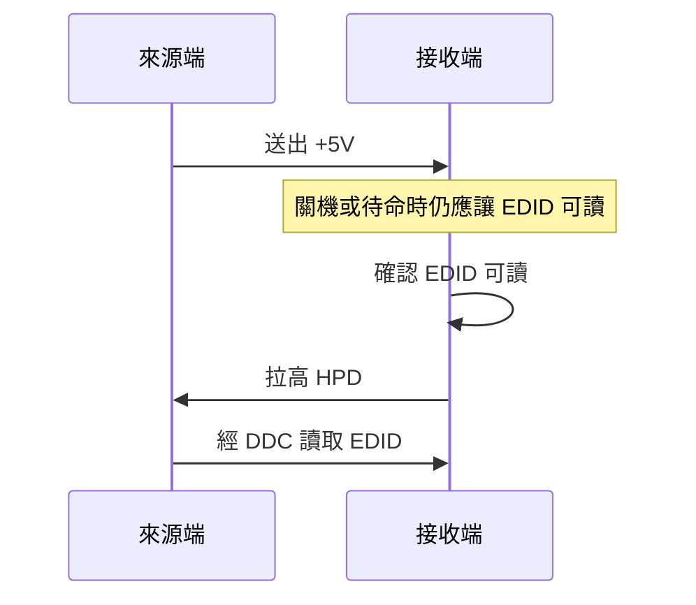

> **重點摘要**：EDID 是 VESA 定義的資料結構，存在顯示器的 EEPROM，來源端透過 DDC 讀取後才知道螢幕支援哪些時序與功能。HDMI 口的前 128 位元組須為 EDID 1.3（HDMI 1.4 PDF p.161）；DisplayPort 的 box-to-box 接收端則須支援 EDID 1.4（DP 2.0 PDF p.996）。韌體工程師在 bring-up、認證送測、客訴分析與產線都會用到它。下面先給讀取流程與 Block 0 地圖，再用 edid-decode 拆一份示意 EDID，並整理常見問題。

## 為什麼重要

當你把一台新螢幕接上筆電，作業系統「自動」跳出正確解析度、更新率、HDR 選項，背後靠的就是 EDID（Extended Display Identification Data）。EDID 就是顯示器的「身分證」：它告訴來源端（source；顯卡、主機板、遊戲主機）「我是誰、我支援什麼解析度、我的色域是多少、我要用什麼時序」。

身為顯示器韌體工程師，你會在這些場合用到 EDID：

- **Bring-up 階段**：確認 panel 規格對應的 EDID 是否正確燒錄在 EEPROM
- **認證送測**：VESA DP CTS、HDMI CTS 都會檢查 EDID 結構是否合規
- **客訴分析**：使用者反應「解析度錯誤、HDR 不亮、VRR 不支援」，第一步都是用 `edid-decode` 看 EDID 有沒有少宣告能力
- **產線校正站**：自動化讀取 EDID，驗證機種、序號、製造週期

下面用 `edid-decode` 拆一份示意 EDID，並把規格裡對填寫與讀取的要求寫清楚。工具安裝與練習放在文末「動手練習」。

## 核心概念

### EDID 是什麼

EDID 是 VESA 定義的標準資料結構，儲存在顯示器內部的 I²C EEPROM。HDMI 規格要求來源端能以 DDC 位址 0xA0 讀取 EDID 1.3（這是 8 位元寫入位址，對應 7 位元 0x50；HDMI 1.4 PDF p.168）。來源端在熱插拔偵測（HPD）為高之後讀取 EDID，才知道顯示器支援的時序與功能。

- **Block 0（Base Block）**：固定 128 位元組（E-EDID A2 PDF p.19）。含製造商資訊、色度座標、基本時序清單，以及 4 個 18 位元組描述子。
- **Extension Blocks**：每個也是 128 位元組。HDMI 常見的是 CTA-861 Extension（Tag 02h），用來放 VIC、音訊、HDR、Vendor-Specific Data（HDMI VSDB、HDMI Forum、廠商 VRR 等）。
- **DisplayID**：較新的 VESA 標準，可與 EDID 共存或在部分產品取代部分宣告；進階復原與共存細節見本系列已發表的進階 checksum／DisplayID 文，本文不展開。

> **提示：**
> 一份完整的 E-EDID 可以由 Block 0 加上最多數百個 extension 組成（E-EDID A2 PDF p.19：不使用 Block Map 時，N 最大為 255，也就是總共最多 256 塊）。不要寫成「最多只能有 4 塊」。

### 來源端怎麼讀到 EDID

對 HDMI 來說，讀取順序不是「上電後直接掃 I²C」這麼簡單。規格把 HPD 與來源端的＋5V 綁在一起，即使接收端（sink）關機或待命，只要來源端有送＋5V，接收端仍應在條件滿足時讓 EDID 可被讀到。



圖 1．HDMI 讀取 EDID 的順序（依 HDMI 1.4 §8.4.4、§8.5，PDF p.168 改寫）

規格要點如下（不要理解成「用電阻把 HPD 直接接到 5V 就結束」）：

- 即使接收端 powered-off 或 standby，**EDID 還不可讀時不得拉高 HPD**；HPD 也只有在偵測到來源端＋5V 之後才可以主張（HDMI 1.4 §8.5，PDF p.168）。
- ＋5V 到達後，接收端宜在 20 ms 內經 Enhanced DDC 提供 E-EDID（HDMI 1.4 PDF p.168，用詞是 should）。
- 來源端須能以 DDC 位址 0xA0 讀 EDID 1.3；讀取 extension 時使用 Segment Pointer，規格寫的是 DDC 位址 0x60（對應 7 位元 0x30；HDMI 1.4 PDF p.168）。
- EDID 內容變更時，HPD 低脈衝至少 100 ms（HDMI 1.4 PDF p.168）。時序與除錯細節見本系列已發表的 checksum／HPD toggle 文。

> **注意：**
> 許多接收端會用 1 kΩ 把 HPD 接到＋5V（HDMI 1.4 §4.2.9，PDF p.88）。這是規格提到的常見作法，不是「唯一合法接法」。

### 表 1．Block 0 地圖（先看全貌）

表 1 依 E-EDID A2 Table 3.1（PDF p.19）改寫，欄位說明用自己的話，不是規格表格原文。範例值來自後文的示意 `edid-decode` 輸出，不是實機樣本。

| 位址 | 長度 | 欄位 | 說明 | 範例值 |
| --- | --- | --- | --- | --- |
| 00h–07h | 8 | Header | 固定辨識碼（E-EDID A2 PDF p.19） | `00 FF FF FF FF FF FF 00` |
| 08h–09h | 2 | Manufacturer Name | ISA PNPID，三個字母壓成 15 位元（PDF p.21） | 示意 `ABC` |
| 0Ah–0Bh | 2 | Product Code | 廠商自定，little-endian（PDF p.19） | 示意 `1234` |
| 0Ch–0Fh | 4 | Serial Number | 32-bit 序號，可不用（PDF p.19、p.22） | 示意 `0` |
| 10h | 1 | Week | 01h–36h 表示第 1–54 週；00h 未指定；FFh 表示 11h 是型號年（PDF p.22） | 示意 `12` |
| 11h | 1 | Year | 儲存值＝西元年−1990（PDF p.22） | 示意 `2024`→34 |
| 12h–13h | 2 | Version／Revision | 1.4 寫 01h 04h（PDF p.19）。**HDMI 口須為 01h 03h**，見下一小節 | 示意 `1.4`（DP／通用） |
| 14h | 1 | Video Input | bit 7＝1 表示數位輸入（PDF p.19；細節見 §3.6.1） | 示意 Digital |
| 15h–16h | 2 | 影像尺寸 | 以公分計；0 表示未指定（PDF p.19） | 示意 60 cm × 34 cm |
| 17h | 1 | Gamma | 工廠預設 Gamma（PDF p.19） | 示意 2.20 |
| 18h | 1 | Feature Support | bit 1＝Preferred Timing Mode 是否含原生像素格式與偏好更新率；bit 0＝連續頻率（PDF p.27） | 見下文 |
| 19h–22h | 10 | Color Characteristics | 紅、綠、藍、白的 10-bit 色度（PDF p.19） | 見下文 |
| 23h–25h | 3 | Established Timings | byte 23h bit 5＝640×480@60（PDF p.30） | 見下文 |
| 26h–35h | 16 | Standard Timings | 8 組、每組 2 位元組；未用須填 01h 01h（PDF p.30–31） | 見下文 |
| 36h–47h | 18 | 描述子 1 | 必須是 Preferred Timing Mode（PDF p.19、p.32） | 示意 3840×2160 |
| 48h–59h | 18 | 描述子 2 | 時序或 Monitor Descriptor（PDF p.19） | 示意 1920×1080 |
| 5Ah–6Bh | 18 | 描述子 3 | 同上 | 示意 Name 0xFC |
| 6Ch–7Dh | 18 | 描述子 4 | 同上 | 示意 Range 0xFD |
| 7Eh | 1 | Extension Count | 後面還有幾個 128 位元組 block（PDF p.19） | 示意 `01` |
| 7Fh | 1 | Checksum | 本塊 128 位元組加總須為 0（PDF p.19） | 示意 `33h` |

### HDMI 用 EDID 1.3，DisplayPort 用 EDID 1.4

後文的 `edid-decode` 輸出把版本寫成 1.4，那是 **DP／通用 1.4 示意**，不是 HDMI 口該燒的內容。

- HDMI 1.4 規定：E-EDID 的前 128 位元組 **shall** 為 EDID 1.3 結構，並符合 CEA-861-D（HDMI 1.4 §8.3，PDF p.161）。換成分位，版本欄位應是 01h 03h。第一個 extension 須為 CEA Extension version 3，不得用 version 1 或 2（同頁 §8.3.1）。
- HDMI 2.1 原版把 CTA Extension 寫成與 EDID 1.3 相容（HDMI 2.1 PDF p.38），並大量引用 H14b。GRL 所稱「填 01 04 過不了 HDMI 1.4b Compliance Test」：本地沒有 1.4b 與 CTS 文本，標 **待查證**。就 HDMI 1.4 本文而言，HDMI 口填 1.4 已違反 §8.3。
- DisplayPort 2.0 在 SST、box-to-box 的接收端條款寫：該接收端 shall support EDID r1.4（DP 2.0 §5.2.1，PDF p.996）。這是該節的適用範圍，不是「所有 DP 產品都自動適用」的概括句。
- 雙介面機種應準備兩份 EDID，不要讓 HDMI 口直接燒 1.4。

### 讀不到 EDID 時的 Non-PnP 與 640×480

HDMI 接收端必須能收 640×480p。除了這個格式以外，被要求支援的格式都必須在 E-EDID 裡聲明；640×480p 因為所有接收端都必須支援，**在 EDID 裡要不要明示是可選的**（HDMI 1.4 §8.3.6，PDF p.167）。CTA-861-H 也寫個人電腦、DVI、CTA-861 都以 640×480p 為預設共通格式（CTA-861-H A.2.8，PDF p.178）。

若來源端讀不到或看不懂 EDID，有的驅動會把螢幕標成 Generic Non-PnP Monitor，並退到 640×480p60；有的則會標 Inactive，不出畫面。這是驅動實作差異，不是單一作業系統的保證行為（**待查證**：本地無 Windows／GPU 驅動規格可核；GRL 亦寫「依各家顯示卡而異」）。

> **待查證：**
> 「出現 Generic Non-PnP 或 Inactive 時，某一家作業系統或顯示卡驅動一定會怎麼做」這件事，目前只能當現象觀察，不能寫成規格保證。

## 一步一步：看懂 edid-decode 輸出

以下輸出是示意（一台 27 吋 4K 螢幕的口吻），用來對照表 1，不是實機樣本。版本欄位是 1.4，請同時記住上一節：HDMI 口應使用 EDID 1.3。

```
Block 0, Base EDID:
  EDID Structure Version & Revision: 1.4
  Vendor & Product Identification:
    Manufacturer: ABC
    Model: 1234
    Serial Number: 0
    Made in: week 12 of 2024
  Basic Display Parameters & Features:
    Digital display
    Maximum image size: 60 cm x 34 cm
    Gamma: 2.20
    DPMS levels: Off
    RGB color display
    First detailed timing is the preferred timing
  Color Characteristics:
    Red  : 0.640, 0.330
    Green: 0.300, 0.600
    Blue : 0.150, 0.060
    White: 0.313, 0.329
  Established Timings I & II:
    DMT 0x04:   640x480    59.940 Hz   4:3    31.469 kHz   25.175 MHz
    DMT 0x10:  1024x768    60.004 Hz   4:3    48.363 kHz   65.000 MHz
  Standard Timings:
    DMT 0x52:  1920x1080   60.000 Hz  16:9    67.500 kHz  148.500 MHz
    DMT 0x55:  1280x720    60.000 Hz  16:9    45.000 kHz   74.250 MHz
  Detailed Timing Descriptors:
    DTD 1:  3840x2160   59.997 Hz  16:9   133.312 kHz  533.250 MHz (600 mm x 340 mm)
                 Hfront   48 Hsync  32 Hback  80 Hpol P
                 Vfront    3 Vsync   5 Vback  33 Vpol N
    DTD 2:  1920x1080   60.000 Hz  16:9    67.500 kHz  148.500 MHz (600 mm x 340 mm)
                 Hfront   88 Hsync  44 Hback 148 Hpol P
                 Vfront    4 Vsync   5 Vback  36 Vpol P
    Display Product Name: 'ABC 27" 4K Monitor'
    Monitor Range Limits:
      Monitor ranges (CVT): 30-144 Hz V, 30-160 kHz H, max dotclock 600 MHz
  Extension blocks: 1
Checksum: 0x33
```

### Header 與製造商資訊（00h–13h）

| 位址 | 長度 | 欄位 | 說明 | 範例值 |
| --- | --- | --- | --- | --- |
| 00h–07h | 8 | Header | 固定為 `00 FF FF FF FF FF FF 00`（E-EDID A2 PDF p.19） | 同上 |
| 08h–09h | 2 | Manufacturer | 三個大寫字母，A＝00001b…Z＝11010b，byte 08h 的 bit 7 必須為 0（PDF p.21） | `ABC`→`04h 43h` |
| 0Ah–0Bh | 2 | Product Code | little-endian，廠商自定（PDF p.19） | 示意 `1234` |
| 0Ch–0Fh | 4 | Serial | 32-bit；未用可為 0（PDF p.22） | 示意 `0` |
| 10h–11h | 2 | Week／Year | 週次 1–54；年＝1990＋儲存值（PDF p.22） | 週 12、年 2024 |
| 12h–13h | 2 | Version | HDMI 口應為 01h 03h（HDMI 1.4 PDF p.161）；本示意是 01h 04h | 示意 `1.4` |

「ABC」的編碼：A＝00001、B＝00010、C＝00011，串成 15 位元並把 byte 08h bit 7 設 0，得到 `0000 0100 0100 0011`，也就是 `04h 43h`（E-EDID A2 Table 3.5，PDF p.21）。不要再寫成 `04h 21h`。

### Basic Display Parameters（14h–18h）

```
Digital display          ← 14h bit 7＝1，數位介面（E-EDID A2 PDF p.19）
Maximum image size: 60 cm x 34 cm  ← 15h、16h（0＝未指定）
Gamma: 2.20              ← 17h 存放工廠預設 Gamma
DPMS levels: Off         ← 18h bit 7–5 與電源管理模式有關（PDF p.27）
RGB color display        ← 類比時，18h bit 4–3 可表示 RGB 彩色；數位時這兩位改表示色彩編碼（PDF p.27）
First detailed timing is the preferred timing  ← 對應 18h bit 1（Preferred Timing Mode，PDF p.27），不是 bit 0
```

18h 的 bit 0 表示是否為連續頻率顯示，不是 Preferred Timing 旗標（E-EDID A2 Table 3.14，PDF p.27）。

### 色度座標（19h–22h）

10 個位元組編碼 8 個 10-bit 值：Rx、Ry、Gx、Gy、Bx、By、Wx、Wy（E-EDID A2 PDF p.19）。示意輸出的 `Red: 0.640, 0.330` 看起來像常見 sRGB／Rec.709 紅原色；精確到小數位的標準值請對公開色彩標準，**不是** E-EDID 本文列出的表（待查證小數位與捨入）。

> **提示：**
> EDID 回報的座標是面板宣告的色度，不代表輸出一定準。工廠校正（3D LUT 或 3×3 矩陣）是否達得到某個 ΔE，要另用儀器驗證。

### Established Timings（23h–25h）

這 3 個位元組是點陣圖，對應早期固定時序。E-EDID A2 Table 3.18（PDF p.30）寫得很清楚：

- byte 23h（也就是十進位 byte 35）的 **bit 5**＝640×480@60
- 同一個位元組的 **bit 0**＝800×600@60（不是 640×480）
- byte 24h 的 bit 3＝1024×768@60

VESA PnP 顯示器必須在 Established Timing I 聲明 BASE VIDEO MODE 640×480@60（E-EDID A2 PDF p.29）。CTA-861-H 的範例把 23h 填成 20h，正好只點了 bit 5（CTA-861-H PDF p.178）。

因此：若產品走 HDMI，或要給電腦來源較穩的共通模式，建議在 Established Timing I 標示 640×480@60（bit 5）。其餘早期時序若產品不支援，對應位元可以為 0。不要再寫「現代螢幕此區常為 0」而不加條件。HDMI 雖然允許不在 EDID 裡明示 640×480p，那是「可選標示」，不是建議整區清空（HDMI 1.4 PDF p.167）。

### Standard Timings（26h–35h）

共 8 組，每組 2 位元組（E-EDID A2 Table 3.19，PDF p.31）：

- 第一個位元組：水平像素＝（儲存值＋31）×8
- 第二個位元組 bit 7–6：長寬比（00＝16:10，01＝4:3，10＝5:4，11＝16:9；1.3 之前 00 曾表示 1:1）
- 第二個位元組 bit 5–0：垂直更新率＝儲存值＋60 Hz（範圍 60–123 Hz）

以 1920×1080@60、16:9 為例：第一位元組＝（1920÷8）−31＝209＝D1h；第二位元組＝11b 加上更新率差 0，得到 C0h（E-EDID A2 PDF p.31）。示意輸出裡的「DMT 0x52」是 edid-decode 給的 DMT 編號，**不是** Standard Timing 這兩個位元組本身。

未使用的組必須填 01h、01h（E-EDID A2 PDF p.30；CTA-861-H A.2.9，PDF p.178–179）。不要填 00h 00h。

### 詳細時序描述子 DTD（36h 起）

四組 18 位元組描述子裡，**第一組必須是 Preferred Timing Mode**（E-EDID A2 Table 3.20，PDF p.32）。對大多數平面顯示器，這通常就是面板原生時序。

點時脈存在 DTD 的前 2 個位元組，little-endian，單位 10 kHz（E-EDID A2 Table 3.21，PDF p.33）。更新率＝點時脈／（H Total × V Total），其中 H Total＝H Active＋H Blanking，V Total＝V Active＋V Blanking。

> **注意：**
> 上方示意輸出寫 533.250 MHz、Hfront 48、Hsync 32、Hback 80、Vfront 3、Vsync 5、Vback 33。這些數字是示意，彼此手算時未必自洽。請用實機 EDID 套公式，不要把這組數字當黃金樣本。

關鍵欄位對照：

- `Hfront`＝H Sync Offset（前廊）
- `Hsync`＝H Sync Pulse Width（同步脈寬）
- `Hback`＝H Blanking − H Sync Offset − H Sync Pulse Width（後廊）
- `Hpol P/N`＝H Sync 極性
- 垂直方向同理：Vfront、Vsync、Vback、Vpol

### 必要與建議的非時序描述子

當某組 18 位元組的前 2 個位元組為 `00 00`，第 3 個位元組（實際是 byte 3，從 0 起算）為 Tag（E-EDID A2 PDF p.36）：

| Tag | 名稱 | 說明 |
| --- | --- | --- |
| `0xFC` | Display Product Name | ASCII 名稱，最多 13 字元（E-EDID A2 PDF p.36） |
| `0xFD` | Display Range Limits | 水平／垂直頻率範圍、最大點時脈，以及 GTF／CVT 資訊（PDF p.36） |
| `0xFE` | Alphanumeric Data String | 未指定用途的 ASCII 字串（PDF p.36） |
| `0xFF` | Product Serial Number | ASCII 序號（PDF p.36） |
| `0x10` | Dummy Descriptor | 填充用，這是唯一允許的填法例外（PDF p.32、p.36） |

EDID 1.3 曾要求要有 Display Range Limits 與 Display Product Name；到了 EDID 1.4，這兩項改為建議（optional but recommended），但第一組描述子仍必須是 Preferred Timing（E-EDID A2 PDF p.32）。CTA-861-H A.2.10 還寫：Block 0 裡的 DTD 必須排在兩個必要的 Monitor Descriptor 之前（CTA-861-H PDF p.179）。

HDMI 走的是 EDID 1.3 結構（HDMI 1.4 PDF p.161），因此 HDMI 口實務上仍應具備 Preferred DTD、Monitor Name（0xFC）與 Range Limits（0xFD）。HDMI 1.4 本文沒有出現「Monitor Name／Range Limits」這幾個字，GRL 所稱「根據 HDMI 規範必須有 Name 與 Range Limits」是繼承 EDID 1.3 的結構，直接條文對照標 **待查證**。DP 口若走 EDID 1.4，不要把 1.3 的必備清單原封不動套上去。

示意輸出中的 Name 與 Range Limits，對應 Tag 0xFC 與 0xFD。

### Extension 計數與 checksum（7Eh–7Fh）

- 7Eh＝`01` 表示後面還有 1 個 extension（通常是 CTA-861）。
- 7Fh 是 checksum：本塊 128 位元組加總必須為 0（E-EDID A2 PDF p.19）。示意值 `33h` 只用來展示概念。

若 extension 數大於 1，EDID 1.3 規定 Block 1 必須是 128 位元組的 Block Map（tag F0h）；EDID 1.4 則改為可選（E-EDID A2 PDF p.16–17）。後來還有 HF-EEODB（CTA Extended Tag 120，CTA-861-H PDF p.130）這種較短的替代寫法，格式指向 HDMI Forum 文件；本地 HDMI 2.1 2017 原文沒有 EEODB，佈局細節 **待查證**。入門只先記住：byte 126 不是「隨便填個 1 就結束」，塊數一多就要核對 Block Map 或後續替代寫法。

> **提示：**
> 若 `edid-decode` 報 `Checksum error`，代表讀取損壞或 EEPROM 未正確燒錄。除錯與 HPD 重讀見本系列已發表的 checksum／HPD 文。

### CTA-861 Block 1 開頭與 HDMI VSDB（只抓骨架）

HDMI 的第一個 extension 必須是 CEA／CTA Extension version 3（HDMI 1.4 §8.3.1，PDF p.161）。開頭四個位元組依 CTA-861-H Table 58（PDF p.127）：

| 位址 | 長度 | 欄位 | 說明 | 範例值 |
| --- | --- | --- | --- | --- |
| 00h | 1 | Tag | 必須是 02h（CTA-861-H PDF p.127） | `02h` |
| 01h | 1 | Revision | 必須是 03h；version 1、2 已不得使用（HDMI 1.4 PDF p.161） | `03h` |
| 02h | 1 | DTD 起始位移 | 沒有 data block 時為 4；為 0 代表後面既沒有 data block 也沒有 DTD（CTA-861-H PDF p.127） | 依內容 |
| 03h | 1 | 旗標與 native DTD 數 | bit 7＝IT underscan、bit 6＝Basic Audio、bit 5＝YCbCr 4:4:4、bit 4＝YCbCr 4:2:2；bit 3–0＝native DTD 數（PDF p.127）。若支援 YCbCr，bit 4 與 bit 5 必須同時為 1（HDMI 1.4 PDF p.167） | 見示意輸出 |

Data Block 用 CTA Tag 區分，常見的有：Video（1）、Audio（2）、Speaker Allocation（4）、Vendor-Specific（3）、Extended（7）。Extended Tag 裡，Colorimetry＝5、HDR Static Metadata＝6、HF-SCDB＝121、HF-EEODB＝120（CTA-861-H Table 62，PDF p.130）。完整 tag 表與音訊必備項、VCDB 細節留給後續專文，本文不展開。

HDMI VSDB 只需先記住這幾句：

- HDMI 接收端的第一個 CTA extension **必須有** HDMI VSDB（IEEE OUI 00-0C-03），至少含 2 位元組的 Source Physical Address，整塊最少 5 位元組（HDMI 1.4 §8.3.2，PDF p.161–162）。
- 根裝置自己的物理位址是 0.0.0.0；寫進各輸入埠 EDID、給來源端讀的，是根裝置幫該埠編的位址。電視機常見第一個輸入為 1.0.0.0，其後 2.0.0.0、3.0.0.0（HDMI 1.4 §8.7，PDF p.169–170）。
- 沒有合法 HDMI VSDB（或沒有 CEA Extension）的裝置，來源端應視為 DVI（HDMI 1.4 §8.3.5，PDF p.166）。
- HDMI 2.1 仍要求 H14b-VSDB 一直存在，HF-VSDB 不能取代它（HDMI 2.1 §10.3.2，PDF p.342）。2.1 能力也可以改寫成 HF-SCDB（Extended Tag 121，CTA-861-H PDF p.130）；與 HF-VSDB 的封裝對照、以及本地 2017 版 HDMI 2.1 未收錄的後續格式，標 **待查證**。

示意的 Block 1 輸出（同樣不是實機樣本）：

```
Block 1, CTA-861 Extension Block:
  Revision: 3
  Underscans IT Video Formats by default
  Basic audio support
  Supports YCbCr 4:4:4
  Supports YCbCr 4:2:2
  Native detailed modes: 1
  Video Data Block:
    VIC   1:   640x480    59.940 Hz   4:3    31.469 kHz   25.175 MHz
    VIC   4:  1280x720    60.000 Hz  16:9    45.000 kHz   74.250 MHz
    VIC  16:  1920x1080   60.000 Hz  16:9    67.500 kHz  148.500 MHz
    VIC  97:  3840x2160   60.000 Hz  16:9   135.000 kHz  594.000 MHz
  Audio Data Block:
    Linear PCM: Max channels 2, 48/44.1/32 kHz, 24/20/16 bits
  Vendor-Specific Data Block (HDMI), OUI 00-0C-03:
    Source physical address: 1.0.0.0
    DC_36bit
    DC_30bit
    Maximum TMDS clock: 300 MHz
  Vendor-Specific Data Block (HDMI Forum), OUI C4-5D-D8:
    Version: 1
    Maximum TMDS Character Rate: 600 MHz
    SCDC Present
    Supports 12-bits/component Deep Color 4:2:0
  Vendor-Specific Data Block (AMD), OUI 00-00-1A:
    Version: 1.1
    Minimum Refresh Rate: 40 Hz
    Maximum Refresh Rate: 144 Hz
    Flags: MCCS support
  Colorimetry Data Block:
    xvYCC601, xvYCC709, BT2020YCC, BT2020RGB
  HDR Static Metadata Data Block:
    Electro optical transfer functions: SMPTE ST2084
    Desired content max luminance: 400 cd/m²
    Desired content max frame-average luminance: 200 cd/m²
  Detailed Timing Descriptors:
    DTD 3:  1920x1080   60.000 Hz...
Checksum: 0x73
```

示意裡出現的 AMD VSDB（OUI 00-00-1A）與 FreeSync 旗標，以實機 EDID 與廠商文件為準（待查證）。HDMI VSDB 的 Max TMDS 300 MHz、HF-VSDB 的 600 MHz 也只是這份示意的數字，用來對照「有沒有宣告」，不是產品保證值。

## 圖解

### DTD 18 位元組位元圖

圖 2．DTD 18 位元組欄位配置（依 E-EDID A2 Table 3.21，PDF p.33 改寫，示意）

```
Byte index: left is 00h, right is 11h（共 18 欄）
      ┌──┬──┬──┬──┬──┬──┬──┬──┬──┬──┬──┬──┬──┬──┬──┬──┬──┬──┐
      │ Pixel Clock (LE, 10 kHz)    │ Hact │ Hblk │H/Hb│
      │                             │  lsb │  lsb │ msb│
      ├─────────────────────────────┼──────┼──────┼────┤
      │ Vact lsb │ Vblk lsb │V/Vb msb│Hsofs │Hspls │V/H │
      │          │          │ msb    │ lsb  │ lsb  │msb │
      ├──────────┼──────────┼────────┼──────┼──────┼────┤
      │H Size lsb│V Size lsb│H/V msb │H Bor │V Bor │Flags│Pad│
      └──────────┴──────────┴────────┴──────┴──────┴────┘
```

Flags（byte 16）的位元定義見 E-EDID A2 Table 3.22。常見要看的是：bit 7 隔行、bit 2 垂直極性、bit 1 水平極性。bit 0 不要再當成 Preferred Timing 旗標（那個在 Block 0 的 18h bit 1，E-EDID A2 PDF p.27）。

## 常見陷阱

| 現象 | 可能原因 | 排查方向 |
| --- | --- | --- |
| `Checksum error` | EEPROM 燒錄失敗、I²C 讀取干擾 | 用邏輯分析儀抓 DDC 波形；確認寫入保護腳位。機制見本系列 checksum／HPD 文 |
| 解析度卡在 1024×768 | EDID 沒宣告 Preferred DTD，或 DTD 參數錯 | 檢查描述子 1 是否為面板原生時序、點時脈是否正確（E-EDID A2 PDF p.32–33） |
| 出現 Generic Non-PnP，或只剩 640×480 | 來源端讀不到或看不懂 EDID | 先修 checksum、Header 與 Block 0 必備項。驅動是否標 Non-PnP 或 Inactive 待查證 |
| HDMI 口版本填成 01 04 | 誤把 DP 用的 EDID 1.4 燒到 HDMI | HDMI 前 128 位元組須為 1.3（HDMI 1.4 PDF p.161） |
| HDMI 被當成 DVI | 缺少合法 HDMI VSDB（OUI 00-0C-03） | 檢查第一個 CTA extension 是否有至少 5 位元組的 HDMI VSDB（HDMI 1.4 PDF p.161–162、p.166） |
| HDMI 無 4K@60 4:4:4 | 缺 HF-VSDB，或 Max TMDS Character Rate 不足 | 確認仍保留 H14b-VSDB，且 HF-VSDB 未取代它（HDMI 2.1 PDF p.342） |
| HDR 不亮、灰階發白 | 缺 HDR Static Metadata Data Block，或 Colorimetry 無 BT.2020 | HDR SMDB 的 Extended Tag 是 0x06，Colorimetry 才是 0x05（CTA-861-H PDF p.130） |
| VRR 不生效 | 廠商 VSDB 缺失，或最小／最大更新率範圍不含目標 | 以實機 EDID 與廠商文件核對，勿只看示意裡的 AMD 區塊（待查證） |
| 讀不到 Extension Block | 7Eh＝0，或未切換 Segment Pointer | 7Eh 應大於 0；讀超過 256 位元組時須用 Segment Pointer（HDMI 1.4 PDF p.168，位址 0x60） |
| 兩台同款螢幕 EDID 不一樣 | 面板批次或韌體版本不同 | 建立黃金樣本做製程管制 |

## 動手練習

### 練習 0：安裝 edid-decode

```bash
# Arch / Manjaro
sudo pacman -S v4l-utils

# Debian / Ubuntu
sudo apt update && sudo apt install v4l-utils

# Fedora
sudo dnf install v4l-utils
```

安裝後驗證：

```bash
edid-decode --version
# 輸出範例：edid-decode 1.0.0（版本字串依發行套件而定）
```

取得 EDID 的常見方式：

```bash
# 方法 A：用 xrandr 抓取（需 X11）
xrandr --prop | edid-decode

# 方法 B：直接讀取 Linux sysfs
ls /sys/class/drm/card*-*/edid
cat /sys/class/drm/card0-HDMI-A-1/edid | edid-decode

# 方法 C：手邊已有 .bin 或 .hex
edid-decode edid.bin
xxd -r -p edid.hex | edid-decode
```

> **提示：**
> 如果是多螢幕，`xrandr --prop` 會一次列出所有 connector 的 EDID，`edid-decode` 會依序解碼。

### 練習 1：抓取並解碼自己螢幕的 EDID

```bash
ls /sys/class/drm/card*/edid
cat /sys/class/drm/card0-eDP-1/edid | edid-decode
cat /sys/class/drm/card0-eDP-1/edid | edid-decode --preferred-timings
```

觀察重點：

- Manufacturer ID 是否為面板廠代號（例如 SAM、LGD、AUO、BOE、CMN）？
- Preferred DTD 的解析度、更新率是否符合面板規格書？
- 這是 HDMI 口還是 DP 口？版本欄位是 01 03 還是 01 04？
- Established Timing I 的 bit 5 有沒有點 640×480@60？
- 是否有 CTA-861 Extension（Extension blocks ≥ 1）？若是 HDMI，有沒有 OUI 00-0C-03 的 VSDB？

### 練習 2：手動驗證 DTD 更新率

```bash
cat /sys/class/drm/card0-eDP-1/edid | xxd | head -80
```

找到 DTD 1（offset 36h＝54 起），依 E-EDID A2 PDF p.33 手算：

- 點時脈（bytes 0–1，little-endian，單位 10 kHz）
- H Active、H Blanking（bytes 2–4）
- V Active、V Blanking（bytes 5–7）
- 計算 H Total、V Total、更新率，對照 `edid-decode` 輸出

### 練習 3：匯出測試用陣列（進階）

```bash
edid-decode --format=carray edid.bin > edid_carray.h
```

可在陣列上改參數，但改完必須重算 checksum（7Fh），再用 `edid-decode` 讀回驗證，不要手刻一份不完整的轉換程式就直接燒錄。

> **注意：**
> 修改 EDID 須確保該塊 128 位元組加總為 0（E-EDID A2 PDF p.19）。`edid-decode` 讀取時會自動驗證 checksum。

## 自我檢測

<details>
<summary>點擊展開答案</summary>

Q1: EDID Base Block 固定多少位元組？Header 固定模式為何？

> A: 128 位元組。Header（00h–07h）固定為 `00 FF FF FF FF FF FF 00`（E-EDID A2 PDF p.19）。

Q2: Manufacturer ID「ABC」如何編碼在 EDID 中？

> A: 三個大寫字母各佔 5 位元，共 15 位元放在 08h–09h，08h 的 bit 7 保留為 0。A＝1、B＝2、C＝3，得到 `04h 43h`（E-EDID A2 Table 3.5，PDF p.21）。不是 `04h 21h`。

Q3: DTD 中點時脈單位為何？若 bytes 0–1 為 `8C 0A`（little-endian），點時脈為多少 MHz？

> A: 單位 10 kHz。`0x0A8C`＝2700 → 27.00 MHz（E-EDID A2 PDF p.33）。

Q4: CTA-861 Extension 中，哪個 Data Block 宣告支援 HDR10（SMPTE ST 2084 PQ）？它的 Extended Tag 是多少？

> A: HDR Static Metadata Data Block，Extended Tag 是 0x06。0x05 是 Colorimetry Data Block（CTA-861-H Table 62，PDF p.130）。

Q5: 用 edid-decode 如何只輸出 CTA-861 的 Video Identification Codes（VIC）？

> A: `edid-decode --timings=CTA edid.bin`（以你安裝的 edid-decode 說明為準，指令列若有差異待查證）。

</details>

## 常見問題

### 為什麼 HDMI 口不能把 EDID 版本欄位填成 01 04？

因為 HDMI 1.4 要求前 128 位元組必須是 EDID 1.3 結構（HDMI 1.4 §8.3，PDF p.161），版本欄位應為 01h 03h。01h 04h 是 EDID 1.4，適用於 DisplayPort box-to-box 接收端這類條款（DP 2.0 PDF p.996），不要直接燒到 HDMI 口。是否因此無法通過 HDMI 1.4b CTS，本地沒有 CTS 文本，待查證；就 1.4 本文而言，已經違反 shall。

### 顯示器關機時，來源端為什麼有時還讀得到 EDID？

因為 HDMI 規定這項可讀性在接收端 powered-off 或 standby 時仍要滿足，條件是來源端有送＋5V，且接收端只有在 EDID 確實可讀之後才拉高 HPD（HDMI 1.4 §8.5，PDF p.168）。＋5V 到達後，宜在 20 ms 內提供 E-EDID（同頁）。

### 為什麼 EDID 讀失敗時，螢幕會變成 Generic Non-PnP，解析度只剩 640×480？

HDMI 接收端本來就必須能收 640×480p，而且這個格式在 EDID 裡不必明示（HDMI 1.4 PDF p.167）；它也是 PC／DVI／CTA 的共通後備格式（CTA-861-H PDF p.178）。來源端若讀失敗，有的驅動會標 Non-PnP 並退到 640×480p60，有的會標 Inactive。這是驅動行為，不是規格保證，待查證。

### 沒有 HDMI VSDB 會發生什麼事？

來源端應把該裝置當成 DVI，而不是 HDMI（HDMI 1.4 §8.3.5，PDF p.166）。所以 HDMI 口不能省略 OUI 00-0C-03 的 VSDB，也不能用後來的 HF-VSDB 取而代之（HDMI 2.1 PDF p.342）。

### Established Timing 的哪一個位元代表 640×480@60？

是 byte 23h（十進位 byte 35）的 **bit 5**，不是 bit 0。bit 0 是 800×600@60（E-EDID A2 Table 3.18，PDF p.30）。CTA-861-H 範例把 23h 填成 20h，就是只點這個位元（PDF p.178）。

### HF-VSDB 和 HF-SCDB 有什麼差別？

兩者都用來宣告 HDMI Forum／2.1 相關能力。HF-VSDB 走 Vendor-Specific Data Block 與 HDMI Forum OUI；HF-SCDB 走 Extended Tag 121（CTA-861-H PDF p.130）。GRL 寫兩者在後段 SCDS 內容大致相同、只是開頭封裝不同。本地 HDMI 2.1 2017 原文沒有 HF-SCDB 字樣，格式應對照後續 HDMI Forum 文件，待查證。實作時不要讓兩種寫法互相矛盾。進階欄位留給後續專文。

## 參考資料

1. VESA Enhanced EDID Standard Release A, Revision 2（2006-09-25）— 定義 Base Block、DTD、描述子與 checksum。本地使用非正式副本核對頁碼；公開鏡像（非官方）：https://glenwing.github.io/docs/VESA-EEDID-A2.pdf
2. CTA-861-H（2021-01；未壓縮高速數位介面的 DTV 設定檔）— CTA Extension、Data Block、Extended Tag。https://ia800407.us.archive.org/26/items/ansi-cta-861-h-final/ANSI-CTA-861-H-Final.pdf
3. HDMI Specification 1.4（2009-06-05；本地文本，不是 1.4b）— §8.3 要求 EDID 1.3、§8.3.5 DVI 判別、§8.4／§8.5 讀取與 HPD、§8.7 物理位址。
4. HDMI Specification 2.1 原版（2017-11-13；本地文本，不是 2.1a／2.1b）— §10.3.2 規定 H14b-VSDB 必須保留（PDF p.342）。
5. VESA DisplayPort Standard version 2.0 — SST box-to-box 接收端須支援 EDID r1.4（PDF p.996）。
6. 李清宇 Peter Lee，《顯示器的身份證 – EDID 是什麼？》，GraniteRiverLabs Taiwan，2021-12-16，AN-211216-TW（非官方教學）：https://www.graniteriverlabs.com/zh-tw/technical-blog/edid-overview
7. DamienChen，《EDID 入門篇》，HackMD，2025-04-07 建立、2025-04-09 更新（台北時間；非官方教學，部分沿用 GRL，Block 0 未寫完）：https://hackmd.io/@DamienChen/r15IkgWC1x
8. edid-decode man page（v4l-utils）— 工具指令參考：https://man.archlinux.org/man/extra/v4l-utils/edid-decode.1.en

> **規格查證提醒**：VESA E-EDID 完整規格需會員權限下載；本文頁碼以本地非正式副本與上述公開鏡像核對，印刷頁＝PDF 頁。關鍵編碼已改以規格本文為準。仍不確定的條目已標「待查證」，實務請再對手邊 NDA 版與現行 CTS。
