## 為什麼重要

如果你剛進入顯示器產業，或是想轉職到系統廠/ODM（Original Design Manufacturer）做顯示器韌體，這篇文章能幫你建立正確的角色想像。

**「系統廠」與「IC 設計廠」的韌體工程師，工作內容截然不同。** IC 設計廠（如 MediaTek、Realtek、Novatek）專注於開發 Scaler SoC 的 SDK、Reference Code、驅動程式；而系統廠/ODM（如 AOC、ViewSonic、Innolux 系統事業群、Wistron、Compal 等品牌或代工廠）的韌體工程師，則是把晶片廠的 SDK **移植、整合、客製化、除錯、認證、量產**，最終交付一台能賣給消費者的成品顯示器。

了解這個角色的完整職責範圍，能幫助你：
- 面試時精準回答「你會負責什麼」
- 規劃學習路徑：該先補哪些技術債
- 與跨職能團隊（HW、ME、光學、測試、FAE、PM）溝通時，知道自己在整條產線上的定位

---

## 核心概念

| 術語 | 解釋 |
|------|------|
| **系統廠 / System Integrator** | 設計完整顯示器產品、整合面板、主板、機構、電源、韌體，自有品牌或為品牌商代工 |
| **ODM (Original Design Manufacturer)** | 原始設計製造商，負責從產品定義、設計、驗證到量產，客戶通常是品牌商（Dell、HP、Lenovo、ASUS 等） |
| **Scaler SoC** | 顯示器的大腦晶片，負責影像解碼、縮放、色彩處理、OSD、介面協定（DP/HDMI/Type-C）等 |
| **T-CON (Timing Controller)** | 面板時序控制器，將 Scaler 輸出的資料轉換成面板介面（LVDS/V-by-One/eDP）所需的時序 |
| **NPI (New Product Introduction)** | 新產品導入流程，通常分 EVT/DVT/PVT/MP 四個階段 |
| **EVT/DVT/PVT/MP** | Engineering/Design/Production Validation Test / Mass Production，四大驗證階段 |
| **EDID (Extended Display Identification Data)** | 顯示器的「身分證」，告訴來源端（GPU/Console）支援哪些解析度、更新率、色彩格式 |
| **DDC/CI (Display Data Channel / Command Interface)** | 透過 I²C 讓電腦讀寫顯示器設定（亮度、輸入源、色溫等）的協定 |
| **Link Training** | DP/HDMI 高速串列介面建立連線的過程，包含時鐘恢復、均衡化、符號鎖定等步驟 |
| **Factory Calibration** | 產線上用色度計/光譜儀量測並寫入 Gamma、白平衡、3D LUT 等校正參數 |

---

## 一步一步：依專案階段看一天的工作

### 階段 1：EVT（工程驗證）——「先亮燈、再跑通」

**典型一天：**
- 早上：拿到新版主板（EVT1），配合 HW 工程師做 **power sequence 驗證**——用示波器量測各電壓軌上電順序、Scaler reset、panel VCC/VEE、backlight enable 是否符合時序規格
- 中午：燒錄最新 SDK 基底韌體，追蹤 **boot log**，確認 Scaler 進入 main loop、SPI flash 讀取正常、panel timing 設定正確、背光亮起
- 下午：接上 **Unigraf/Quantum Data 訊號產生器**，逐一測試 DP/HDMI/Type-C 輸入埠的 **link training**。看 DPCD/SCDC log，調整 EQ/CR 參數，解決「有訊號卻無畫面」或「閃爍、掉訊號」
- 晚間：寫 **EDID/DisplayID**，用 `edid-decode` 驗證每個欄位，確認 GPU 能正確讀取、列出預期解析度

> 💡 **關鍵心態**：EVT 階段「能動就好」，但 log 要加足、錯誤代碼要定義清楚，給後續除錯用。

---

### 階段 2：DVT（設計驗證）——「功能完整、相容性穩、認證預測」

**典型一天：**
- 早上：跑 **完整功能矩陣**——MST daisy-chain、DSC 壓縮、VRR/ALLM/QMS、HDR10/HLG、Local Dimming 區域控制、KVM 切換、USB hub 上下游
- 中午：**相容性測試**——輪換 ≥10 種 GPU（NVIDIA/AMD/Intel）、遊戲主機、Dock、KVM switch、不同長度線材，記錄失敗模式，回報給 Scaler FAE 或自行調整 link 參數
- 下午：配合光學實驗室建立 **factory calibration 流程**。用 CA-410/i1Pro 量測 Gamma、白平衡、色域、DeltaE，撰寫 Python 自動化腳本，目標 ΔE<1.0（視產品定位）
- 晚間：跑 **VESA DP CTS / HDMI CTS / DisplayHDR / USB-IF** 預測項目，整理失敗清單，協同 Scaler FAE 改善

> 💡 **關鍵心態**：DVT 是「找坑」的階段，每一個 fail 都要有根因、有 workaround、有驗證關閉。

---

### 階段 3：PVT（生產驗證）——「產線可複製、節拍達標、風險收斂」

**典型一天：**
- 早上：在 **產線校正站** 驗證燒錄/校正流程。確認 SPI flash 燒錄、EDID 寫入、色彩校正（Gamma/LUT/Uniformity）、功能測試（DDC/CI、鍵盤/搖桿、HPD）單機 takt time 達標
- 中午：分析 **yield 數據**，找出前三大失敗模式，推動 8D 改善
- 下午：**FW release 管理**——版號規則、release note、rollback 策略、OTA/USB/DDC-CI 更新驗證、斷電恢復測試
- 晚間：整理 **PVT 結案報告**，確認所有 open issue 已關閉或有風險接受紀錄

---

### 階段 4：MP（量產維護）——「守住品質、快速回應客訴」

**典型一天：**
- 早上：審視 **RMA/FA 報告**，判斷是 FW bug、硬體邊界、還是使用者設定問題
- 中午：針對系統性問題啟動 **8D**，協同 HW、光學、面板廠、Scaler FAE 找根因，釋出 patch FW
- 下午：評估 **ECN/ECR**——面板 EOL 換料、Scaler 晶片版本升級、PD IC 變更，做風險評估與驗證計畫
- 晚間：追蹤法規更新（ENERGY STAR v8、TCO Gen 10、ErP、RoHS/REACH），評估 FW 影響範圍

---

## 圖解：系統廠韌體工程師的互動網絡

```mermaid
graph TD
    FW[顯示器韌體工程師] --> Scaler[Scaler SoC SDK<br/>MediaTek/Realtek/Novatek]
    FW --> Panel[面板廠<br/>時序/電源序列/OD/保護]
    FW --> HW[硬體工程師<br/>Schematic/Layout/Power/EMC]
    FW --> ME[機構工程師<br/>按鍵/ジョイスティ/散熱/組裝]
    FW --> Optical[光學/色彩工程師<br/>Calibration/Uniformity/HDR]
    FW --> Test[測試/自動化工程師<br/>HIL/Regression/Cal Station]
    FW --> FAE[FAE/客訴處理<br/>RMA/8D/Field Issue]
    FW --> PM[專案經理<br/>Schedule/Risk/Gate]
    FW --> Cert[認證實驗室<br/>VESA/HDMI/USB-IF/DisplayHDR]
    
    style FW fill:#1e3a5f,color:#fff
    style Scaler fill:#2d5a3e,color:#fff
    style Panel fill:#5a3e2d,color:#fff
    style HW fill:#3e2d5a,color:#fff
    style ME fill:#2d5a5a,color:#fff
    style Optical fill:#5a2d4e,color:#fff
    style Test fill:#4e5a2d,color:#fff
    style FAE fill:#5a4e2d,color:#fff
    style PM fill:#2d3e5a,color:#fff
    style Cert fill:#4a2d5a,color:#fff
```



**文字版（ASCII）備份：**

```
+-------------------------+
|  顯示器韌體工程師 (核心)   |
+-------------------------+
         |    |    |    |    |    |    |    |    |    |
         v    v    v    v    v    v    v    v    v    v
  +--------+ +--------+ +--------+ +--------+ +--------+
  | Scaler | | 面板廠 | |   HW   | |   ME   | | 光學/  |
  |  SDK   | |時序/保護| |原理圖/ | |按鍵/散熱| | 色彩  |
  +--------+ +--------+ |Layout  | +--------+ |校正/HDR|
                        |EMC/電源|            +--------+
                        +--------+
         |    |    |    |    |    |    |    |    |    |
         v    v    v    v    v    v    v    v    v    v
  +--------+ +--------+ +--------+ +--------+ +--------+
  | 測試/  | | FAE/   | |  PM    | | 認證   | | 客戶/  |
  | 自動化 | | 客訴   | |排程/風險| | 實驗室 | | 品牌商 |
  +--------+ +--------+ +--------+ +--------+ +--------+
```

---

## 常見陷阱

| 陷阱 | 說明 | 避免方式 |
|------|------|----------|
| **把 IC 設計廠的 SDK 當黑盒子** | 只會呼叫 API，不懂底層 register、link training 狀態機，遇到相容性問題無法深入除錯 | 必須讀懂 SDK 原始碼關鍵路徑：DP/HDMI link training、EDID parsing、panel timing 設定、color pipeline |
| **忽略面板時序與電源序列** | 以為 Scaler 設定好就沒事，實際上 panel VCC/VEE、backlight enable、HPD timing 錯誤會導致閃爍、殘影、亮燈失敗 | 熟讀面板規格書的 AC/DC timing 章節，用示波器實測每個 power rail 與 HPD/backlight enable 的時序關係 |
| **EDID 寫死不動** | 專案初期寫好 EDID 就不再碰，導致新面板/新功能（HDR、VRR、DSC）未正確宣告 | 建立 EDID 版本管理、自動化驗證腳本（edid-decode + CTA-861/DisplayID parser），每次改版必跑 |
| **色彩校正只靠「肉眼」或單一儀器** | 只用一台 colorimeter、不做 CCMX/CCSS 修正、不驗證 ΔE，出貨後客訴色差 | 建立 SOP：指定儀器、環境燈源、暖機時間、量測點位、修正矩陣、合格門檻、Golden sample 比對 |
| **認證送測前才開始跑 CTS** | DVT 結束才第一次跑完整 CTS，發現大量 fail 來不及改 | DVT 早期就跑關鍵 CTS 項目（link training、EDID、HDCP、HDR metadata），建立「認證預測」機制 |
| **FW 版本管理混亂** | 同一機種有多條 branch、版號無規則、release note 缺失、rollback 不可追溯 | 導入 SemVer 或自訂版號規則、強制 PR 搭配 issue、release note 模板、dual-bank 設計支援安全 rollback |

---

## 動手練習（零成本、可在筆電上完成）

1. **EDID 解析實作**
   ```bash
   # Linux/macOS/WSL
   sudo apt install edid-decode   # 或 brew install edid-decode
   # 抓取目前螢幕 EDID
   xrandr --props | grep -A 30 "EDID"
   # 或用 ddcutil
   sudo apt install ddcutil
   ddcutil detect
   ddcutil capabilities
   ddcutil getvcp 10  # 亮度
   ```
   練習：用 `edid-decode` 解析你螢幕的 EDID，找出：製造商 ID、產品代碼、序號、製造週/年、原生解析度、支援的色域、HDR static metadata block（若有）。

2. **DDC/CI 控制實作**
   ```bash
   # 讀取/設定亮度、對比、輸入源
   ddcutil getvcp 10   # 亮度
   ddcutil setvcp 10 50  # 設定亮度 50%
   ddcutil getvcp 60   # 輸入源
   ddcutil setvcp 60 0x0f  # 切換到 DP（視 capabilities 而定）
   ```
   練習：寫一個 Python 腳本，輪詢亮度變化、記錄 VCP code 回應時間。

3. **時序計算練習**
   - 參考 VESA CVT 2.0 計算 1920×1080@60Hz、2560×1440@144Hz、3840×2160@60Hz 的詳細時序（pixel clock、H/V total、front/back porch、sync width、polarity）
   - 用線上計算器或 `cvt` 指令驗證：`cvt 1920 1080 60`

4. **Git + FW 專案模擬**
   - 建立一個模擬專案 repo：`bootloader/`、`app/`、`common/`、`panel/`、`config/SKU_A/`、`config/SKU_B/`
   - 練習 feature branch → PR → code review → merge → tag release
   - 撰寫一份 `RELEASE_NOTE.md` 模板：版號、日期、新增功能、修正問題、已知限制、相容性備註

---

## 自我檢測

<details>
<summary>點擊展開答案</summary>

**Q1: 系統廠/ODM 韌體工程師與 IC 設計廠韌體工程師最大的差別是什麼？**
> A: 系統廠負責「整合、客製化、認證、量產、維護」完整產品韌體，直接面對面板、機構、光學、產線、客訴；IC 設計廠負責提供 SDK/Reference Code/驅動程式，專注於晶片 IP 驗證與 API 穩定性。

**Q2: EVT、DVT、PVT、MP 四階段中，哪一階段最適合建立自動化測試框架？為什麼？**
> A: DVT。此階段功能相對完整、硬體版本定型、有穩定的測試治具，適合投入自動化開發，並在 PVT 前凍結 regression suite。

**Q3: 顯示器韌體工程師需要會示波器操作嗎？關鍵量測項目有哪些？**
> A: 需要。關鍵量測：power sequence（各電壓軌上電順序/斜率）、HPD 脈衝寬度/時機、PWM 頻率/占空比、DP/HDMI eye diagram、panel VCC/VEE 時序、backlight enable 延遲。

**Q4: 什麼是 Link Training？DP 1.4 (8b/10b) 的四個階段為何？**
> A: Link Training 是高速串列介面建立可靠連線的過程。DP 1.4 四階段：Clock Recovery (CR) → Equalization (EQ) → Symbol Lock → Inter-lane Alignment。

**Q5: Factory Calibration 站通常包含哪些關鍵步驟？**
> A: 1) 燒錄 FW/EDID/序號 2) 暖機 3) 量測原生 Gamma/白平衡/色域 4) 計算並寫入校正參數 5) 量測驗證 ΔE 6) 燒錄 Uniformity/LUT（若支援）7) 最終功能測試 8) 標籤列印/追溯資料上傳 MES。
</details>

---

## 參考資料

1. CDTech LCD Blog - "Driving Unusual Resolutions: Custom Timing, EDID and Scaler Configuration" - https://blog.cdtech-lcd.com/custom-timing-edid-and-scaler-configuration
2. Monitor Insider - "Anatomy of a Monitor" - http://monitorinsider.com/monitor_anatomy
3. Kadi Display - "How to Choose an LCD Controller Board: EDID, Timing & Latency" - https://kadidisplay.com/blog-news/how-to-choose-an-lcd-controller-board-architecture-edid-timing-and-latency
4. LaptopJudge - "What Is Monitor Firmware Configuration?" - https://laptopjudge.com/what-is-monitor-firmware-configuration
5. LaptopJudge - "What Is A Monitor Scaler Chip?" - https://laptopjudge.com/what-is-a-monitor-scaler-chip
6. MobilePixels - "What Is EDID?" - https://mobilepixels.us/pages/what-is-edid
7. IC Navigator - "Monitor Hardware Guide: TCON, HDR, USB-C DP & Backlight" - https://icnavigator.com/applications/consumer-electronics/monitor-hardware-tcon-hdr-usb-c-dp-backlight
8. Firmwatch - "Monitor Firmware: The Update Almost Nobody Knows About" - https://firmwatch.io/blog/monitor-firmware-forgotten-update
9. VESA DisplayHDR Compliance Program - https://vesa.org/displayport-developer/compliance/
10. Allion Labs - "VESA Display HDR Certification Consulting Service" - https://www.allion.com/consulting/displayhdr/
11. Things Embedded - "EVT, DVT and PVT Explained" - https://things-embedded.com/us/faq/evt-dvt-pvt
12. OnLogic - "EVT, DVT, and PVT: Product Development Stages Explained" - https://www.onlogic.com/blog/evt-dvt-and-pvt-product-development-stages-explained
13. Granite River Labs - "顯示器的身份證– EDID 是什麼？" - https://www.graniteriverlabs.com/zh-tw/technical-blog/edid-overview
14. PTT Tech_Job 版 / Dcard 科技業版 - 瑞昱/聯詠/慧榮 Display 韌體工程師面試心得與工作內容討論（業界現況參考）
