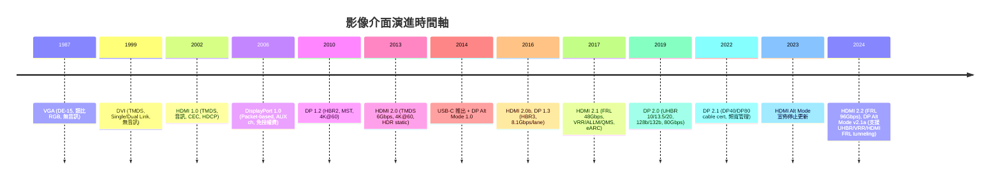
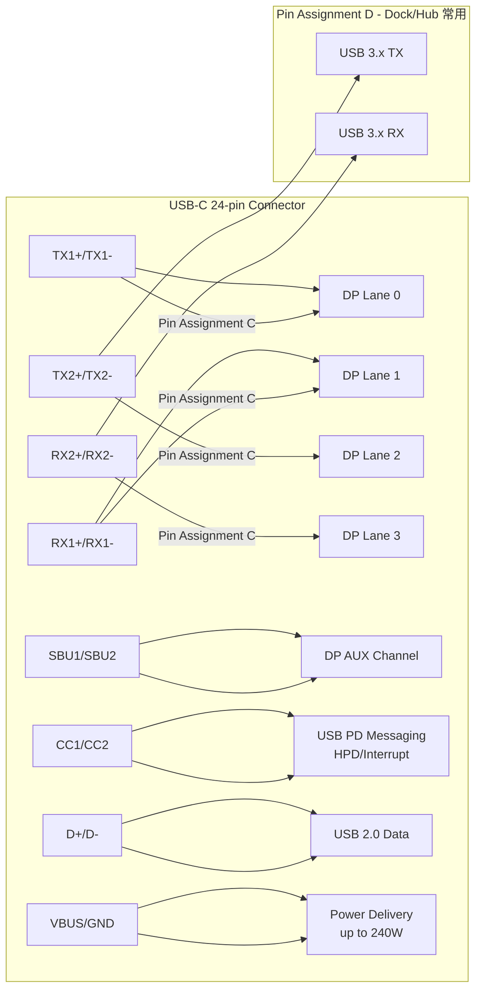

## 為什麼重要

身為顯示器韌體工程師，**影像介面是你每天都要面對的「大門」**。不管是帶新機種 (EVT/DVT/PVT)、除錯「為什麼這台筆電插上去只有 30Hz」、還是寫 EDID、跑 VESA/HDMI/USB-IF 認證，你都得清楚：

- 每個介面的**訊號類型**（類比 vs. 數位）、**編碼方式**、**頻寬上限**
- **連接器長什麼樣**、**腳位定義**、**向下相容怎麼做**（DP++、Alt Mode、passive/active adapter）
- **韌體端要處理什麼**：Link training、EDID/DDC、HDCP、HPD、PD contract、DSC、VRR/ALLM/QMS...

這篇文章帶你一次釐清五大主流介面（VGA、DVI、HDMI、DisplayPort、USB-C）的演進脈絡與關鍵差異，建立「介面地圖」，後續深入 DP link training、HDMI FRL、USB-C PD/Alt Mode 才不會迷路。

---

## 核心概念

| 術語 | 全名 / 說明 |
|------|-------------|
| **VGA** | Video Graphics Array，1987 年 IBM 定義，**類比** RGB 訊號 |
| **DVI** | Digital Visual Interface，1999 年 DDWG 定義，**數位** TMDS 訊號 |
| **HDMI** | High-Definition Multimedia Interface，2002 年推出，消費性電子導向，內建**音訊、CEC、ARC/eARC、HDCP** |
| **DisplayPort (DP)** | 2006 年 VESA 定義，免授權費，PC/專業顯示器主流，**packet-based、MST、DSC** |
| **USB-C / Type-C** | 24-pin 可逆連接器，可透過 **Alt Mode** 傳 DP/HDMI/Thunderbolt 訊號，同時跑 USB 資料與 PD 供電 |
| **TMDS** | Transition Minimized Differential Signaling，DVI/HDMI 1.x~2.0 使用的編碼 (8b/10b)，需獨立 clock lane |
| **FRL** | Fixed Rate Link，HDMI 2.1+ 引入，**固定速率**、4 lanes 同步、無獨立 clock，**16b/18b + RS-FEC** |
| **UHBR** | Ultra High Bit Rate，DP 2.0/2.1 引入，**128b/132b** 編碼，四種速率：UHBR10/13.5/20 (10/13.5/20 Gbps per lane) |
| **DP++ (Dual-Mode)** | DP source 可直接輸出 TMDS (HDMI/DVI) 訊號，用 **passive adapter** 即可轉接，**USB-C 不支援** |
| **Alt Mode** | USB-C 的「替代模式」，將高速差分對改配為 DP/HDMI/Thunderbolt 訊號 |
| **Pin Assignment C/D/E** | DP Alt Mode 三種腳位分配：C=4 lane DP、D=2 lane DP + 2 lane USB 3.x、E=4 lane DP (sink 端 polarity 反向) |
| **MST** | Multi-Stream Transport，單一 DP port 串接多顆顯示器 (daisy-chain) |
| **DSC** | Display Stream Compression，視覺無損壓縮，DP 1.4+/HDMI 2.1 支援，突破頻寬限制 |
| **VRR / ALLM / QMS** | Variable Refresh Rate / Auto Low Latency Mode / Quick Media Switching，HDMI 2.1 遊戲相關功能 |

---

## 一步一步：從類比到 USB-C 的演進時間軸



### 步驟 1：認識五大介面的「身分證」

| 項目 | VGA | DVI | HDMI | DisplayPort | USB-C (DP Alt Mode) |
|------|-----|-----|------|-------------|---------------------|
| **訊號類型** | 類比 | 數位 (TMDS) | 數位 (TMDS/FRL) | 數位 (Packet) | 數位 (DP over Alt Mode) |
| **連接器** | DE-15 (15-pin) | DVI-I/D/D-A (29/24+1 pin) | Type A/C/D/E (19-pin) | 標準 20-pin / Mini DP | 24-pin 可逆 |
| **最大常見解析度** | 1920×1200@60 | SL: 1920×1200@60<br>DL: 2560×1600@60 | 2.1: 8K@60 / 4K@120 | 2.1: 8K@60 4:4:4 / 16K@60 (DSC) | 取決於 DP 版本與 Pin Assignment |
| **音訊** | ❌ | ❌ | ✅ (32-ch, ARC/eARC) | ✅ (可選, 32-ch) | ✅ (隨 DP/HDMI) |
| **電源/PD** | ❌ | ❌ | ❌ (僅 +5V 50mA) | ✅ (DP_PWR 3.3V 500mA) | ✅ **PD 至 240W (EPR)** |
| **向下相容** | — | DVI-I → VGA (passive) | → DVI (passive)<br>→ VGA (active) | **DP++ → HDMI/DVI (passive)** | **僅 Alt Mode，無 DP++** |
| **關鍵特色** | Auto-adjust (clock/phase) | 最後的平行傳輸介面 | 消費電子標配、CEC 單一遙控 | MST daisy-chain、免授權費、DSC 成熟 | **單一埠做一切**：視訊+資料+供電 |

### 步驟 2：理解頻寬怎麼算（別只看行銷數字）

**TMDS (DVI / HDMI 1.x~2.0 / DP 1.x)**：
- 8b/10b 編碼 → **20% 開銷**
- 有效載荷 = 連結速率 × 0.8 × lane 數
- 例：HDMI 2.0 = 6 Gbps × 3 lanes × 0.8 = **14.4 Gbps** 有效視訊頻寬

**FRL (HDMI 2.1/2.2)**：
- 16b/18b 編碼 + **RS-FEC (RS(544,514))** → 約 11% 開銷
- HDMI 2.1 FRL6 (12 Gbps/lane × 4) = 48 Gbps 原始 → **~42.67 Gbps** 有效

**UHBR (DP 2.0/2.1)**：
- 128b/132b 編碼 → **~3% 開銷** (極低！) + **強制 RS-FEC (RS(198,194))**
- UHBR20 = 20 Gbps × 4 lanes = 80 Gbps 原始 → **77.37 Gbps** 有效 (含 FEC)

> 💡 **實務提醒**：DP 2.1 的 128b/132b 開銷極低，加上 DSC (最高 3:1 視覺無損)，單一纜線跑 16K@60 成為可能。但**纜線認證 (DP40/DP80) 與 sink/source 端 PHY 都要支援**才行。

### 步驟 3：USB-C 怎麼同時傳視訊、資料、供電？



- **Pin Assignment C**：4 lane DP，最高頻寬，**無 USB 3.x 資料**（僅 USB 2.0）→ 適用純視訊線、video adapter
- **Pin Assignment D**：**2 lane DP + 2 lane USB 3.2 Gen 2 (10 Gbps)** → 適用 dock、hub、帶 USB port 的監看器，**同時跑 4K@60 + USB 3.x**
- **Pin Assignment E**：4 lane DP，給 **USB-C to DP adapter/cable**，sink 端 polarity 反向
- **關鍵限制**：**USB-C Alt Mode 不支援 DP++**，所以 **USB-C → DP adapter → passive DP→HDMI 轉接頭 = 不會動**；要接 HDMI 必須用 **active converter (DP→HDMI 轉換晶片)**

### 步驟 4：韌體工程師必知的「三條路徑」

```
┌─────────────────────────────────────────────────────────────┐
│                    Monitor 系統六大子系統                       │
├──────────────┬──────────────┬──────────────┬────────────────┤
│   Scaler     │    T-CON     │    Panel     │  Backlight     │
│  (大腦/介面/  │  (序列轉並列/  │  (畫布:       │  (Edge/Direct/ │
│   影像處理/  │   時序產生/   │   LCD/OLED/  │   Mini-LED     │
│   OSD/電源)  │   PSR)       │   Mini-LED)  │   FALD)        │
└──────┬───────┴──────┬───────┴──────┬───────┴───────┬────────┘
       │              │              │               │
       ▼              ▼              ▼               ▼
┌─────────────────────────────────────────────────────────────┐
│  資料路徑: Host → Scaler → T-CON → Panel                      │
│  控制路徑: DDC/CI (I²C) / DP AUX / PD CC line / USB Billboard │
│  電源路徑: AC/DC → 各電壓軌 → VBUS (PD Source/Sink)           │
└─────────────────────────────────────────────────────────────┘
```

- **資料路徑**：決定支援多少解析度/重新率/色深 → 取決於介面頻寬、DSC、panel 介面
- **控制路徑**：EDID 讀取 (DDC/I²C @ 0x50)、MCCS/VCP 控制 (亮度、輸入切換)、DPCD/AUX 設定、PD VDM 協商 Alt Mode
- **電源路徑**：Monitor 可作 **PD Source (輸出 VBUS 給筆電)** 或 **PD Sink (從筆電取電)**，或 **DRP (雙角色)**，FW 需管理功率預算

---

## 圖解：介面家族樹與向下相容關係

```mermaid
graph TD
    VGA[VGA 1987<br/>Analog RGB] -->|Passive Adapter| DVI_I[DVI-I<br/>Digital + Analog]
    DVI_I -->|Passive Adapter| DVI_D[DVI-D<br/>Digital Only]
    DVI_D -->|Passive Adapter<br/>電氣相容| HDMI[HDMI 1.x/2.0<br/>TMDS + Audio + CEC]
    
    DP[DisplayPort 1.0+<br/>Packet + AUX] -->|DP++ Dual-Mode<br/>Passive Adapter| HDMI
    DP -->|DP++ Dual-Mode<br/>Passive Adapter| DVI_D
    
    USBC[USB-C Connector] -->|Alt Mode C/D/E| DP_Alt[DP Alt Mode]
    USBC -->|Alt Mode (已停更)| HDMI_Alt[HDMI Alt Mode]
    USBC -->|Thunderbolt 3/4/5| TBT[Thunderbolt<br/>PCIe + DP Tunneling]
    
    DP_Alt -.->|❌ 不支援 DP++| HDMI
    DP_Alt -.->|需 Active Converter| HDMI
    
    style VGA fill:#ffcccc
    style DVI_I fill:#ffe0cc
    style DVI_D fill:#ffe0cc
    style HDMI fill:#ccffcc
    style DP fill:#cceeff
    style USBC fill:#e0ccff
    style TBT fill:#f0e0ff
```

> **紅框 = 已淘汰/極少新產品採用**  
> **綠框 = 消費電子主流**  
> **藍框 = PC/專業顯示器主流**  
> **紫框 = 現代單一埠整合趨勢**

---

## 常見陷阱

| # | 陷阱 | 正確觀念 |
|---|------|----------|
| 1 | 「HDMI 2.1 輸入一定支援 4K@120」 | **港口版本 ≠ 裝置能力**。需確認 sink 的 EDID/HF-VSDB 宣告的 FRL rate、DSC 支援、TMDS clock 限制 |
| 2 | 「USB-C 插上去就能傳 4K@60」 | 要看 **Pin Assignment (C/D/E)**、host 是否支援 DP 1.4 HBR3、cable 是否為全功能 (Gen 2/Gen 1)、sink 端 DPCD capability |
| 3 | 「DP 1.4 有 DSC 就能跑 8K@60」 | DSC 是**選項**，且需 **slice count、bpp、buffer model** 正確設定；若 sink 不支援 DSC 或參數不符，link training 會失敗或 fallback 到較低解析度 |
| 4 | 「DP++ passive adapter 接在 USB-C→DP adapter 後面能轉 HDMI」 | **USB-C Alt Mode 明文禁止 DP++**，passive DP→HDMI 在此拓樸**一定失效**，必須用 active converter (含轉換晶片) |
| 5 | 「Monitor 只要支援 PD 就能充電筆電」 | Monitor 必須實作 **PD Source (UFP) 角色**，且 VBUS 功率預算要夠 (如 65W/90W/140W)；還要處理 **Role Swap、DR Swap、PR Swap** 狀態機 |
| 6 | 「EDID 只要複製參考設計就好」 | **每個輸入 port 都要獨立 EDID** (HDMI 需 CTA-861 HF-VSDB、DP 需 DPCD capability 一致)；複製錯誤會導致 host 端無法正確識別支援模式 |
| 7 | 「VRR 開啟後畫面閃爍是 panel 問題」 | 可能是 **VRR 範圍 (VRR min/max Hz) 與 panel 支援不符**、或 **LFC (Low Framerate Compensation) 邏輯錯誤**、或 **variable overdrive table 缺失** |

---

## 動手練習

### 練習 1：用 `edid-decode` 解析自家顯示器的 EDID
```bash
# Linux/macOS (需安裝 edid-decode)
sudo apt-get install edid-decode   # Ubuntu/Debian
brew install edid-decode           # macOS

# 讀取 HDMI port EDID (通常在 /sys/class/drm/card*-HDMI-A-*/edid)
edid-decode /sys/class/drm/card0-HDMI-A-1/edid

# 或從檔案讀取 (Windows 可用 dump_edid.exe 或 Monitor Asset Manager)
edid-decode my_monitor_edid.bin
```
**觀察重點**：
- Base block：製造商 ID、產品代碼、序號、製造週/年、EDID 版本
- Established Timings / Standard Timings / Detailed Timing Descriptors (DTD)
- CTA-861 Extension：VIC (Video Identification Codes)、HF-VSDB (HDMI Forum VSDB)、HDR Static Metadata Block
- DisplayID 2.x Extension (若有)：Type 1/2/3/7 區塊

### 練習 2：用 `ddcutil` 讀寫 MCCS VCP 碼
```bash
# 安裝
sudo apt-get install ddcutil i2c-tools
sudo modprobe i2c-dev
sudo usermod -aG i2c $USER  # 重新登入生效

# 偵測所有監看器
ddcutil detect

# 讀取能力字串 (支援哪些 VCP)
ddcutil capabilities

# 讀取/寫入亮度 (VCP 0x10)
ddcutil getvcp 10
ddcutil setvcp 10 50

# 切換輸入源 (VCP 0x60, 值視廠商定義)
ddcutil getvcp 60
ddcutil setvcp 60 0x0F  # 例：DP 輸入
```

### 練習 3：手算一條 DTD 的 pixel clock 與重新率
以 1920×1080@60Hz (CEA VIC 16) 為例：
```
H_active = 1920, H_blank = 280 (front 88 + sync 44 + back 148)
V_active = 1080, V_blank = 45 (front 4 + sync 5 + back 36)
H_total = 2200, V_total = 1125
Pixel clock = H_total × V_total × refresh = 2200 × 1125 × 60 = 148.5 MHz
```
用 `cvt 1920 1080 60` 或 `gtf 1920 1080 60` 驗證。

### 練習 4：用線上工具試算頻寬需求
開啟 [Video Timings Calculator](https://tomverbeure.github.io/video_timings_calculator/)：
1. 輸入解析度、重新率、色深 (8/10/12-bit)、色域 (RGB/4:4:4/4:2:2/4:2:0)
2. 觀察 **Required Bandwidth** 與 **DP/HDMI 各版本最大載荷** 對比
3. 找出需要啟用 DSC 的門檻、或是需要升級介面版本的條件

---

## 自我檢測

<details>
<summary>點擊展開答案</summary>

**Q1: VGA、DVI、HDMI、DisplayPort、USB-C 五者中，哪些是「類比訊號」？哪些支援「音訊」？**
> **答案**：類比只有 **VGA**。支援音訊的有 **HDMI、DisplayPort、USB-C (透過 Alt Mode 傳 DP/HDMI 音訊)**。DVI 無音訊。

**Q2: 什麼是 DP++ (Dual-Mode)？為什麼 USB-C Alt Mode 不支援 DP++？**
> **答案**：DP++ 讓 DP source 直接輸出 TMDS 訊號，透過 passive adapter 接 HDMI/DVI。USB-C Alt Mode 將高速差分對改配為 DP Main Link，**物理層已非 DP 原生訊號**，且 USB-C 規範未定義 DP++ 的 AC-coupling 與 level shifting，故**明文禁止**。

**Q3: HDMI 2.0 (TMDS) 與 HDMI 2.1 (FRL) 在傳輸機制上最大的不同是什麼？**
> **答案**：TMDS 用 **3 data lanes + 1 clock lane**，pixel clock 傳輸，8b/10b 編碼；FRL 用 **4 data lanes 同步固定速率**，**無獨立 clock lane**，16b/18b 編碼 + **RS-FEC**，支援 VRR/ALLM/QMS。

**Q4: DP 2.1 UHBR20 的有效視訊頻寬是多少？為什麼比 80 Gbps 原始頻寬低？**
> **答案**：**77.37 Gbps**。因為 128b/132b 編碼 (~3% 開銷) + **強制 RS(198,194) FEC** 開銷。

**Q5: 你的監看器支援 USB-C DP Alt Mode Pin Assignment D，同時連接筆電 (host) 與 USB 隨身碟。若筆電要求 4K@60 10-bit HDR，且 USB 隨身碟跑 USB 3.2 Gen 2 (10 Gbps)，頻寬夠嗎？**
> **答案**：Pin D = **2 lane DP + 2 lane USB 3.x**。DP 1.4 HBR3 (8.1 Gbps/lane) × 2 = 16.2 Gbps 原始 → 12.96 Gbps 有效 (8b/10b)。4K@60 10-bit 4:4:4 未壓縮需 ~19.6 Gbps，**不夠**；需啟用 **DSC** (視覺無損壓縮) 或降為 8-bit/4:2:2。USB 3.2 Gen 2 10 Gbps 獨立於 DP lanes，**不受影響**。

</details>

---

## 參考資料

1. **VESA DisplayPort Specifications** (公開摘要) — https://displayport.org/specifications/
2. **VESA DisplayPort Alternate Mode on USB Type-C** v1.0b (2017), v2.1a (2024) — https://vesa.org/featured-articles/vesa-releases-updated-displayport-alt-mode-spec-to-bring-displayport-2-0-performance-to-usb4-and-new-usb-type-c-devices/
3. **HDMI Licensing Administrator, HDMI Specifications** — https://www.hdmi.org/spec/index (完整規格需會員/NDA)
4. **Wikipedia: DisplayPort** — https://en.wikipedia.org/wiki/DisplayPort
5. **Wikipedia: High-Definition Multimedia Interface** — https://en.wikipedia.org/wiki/High-Definition_Multimedia_Interface
6. **Wikipedia: Digital Visual Interface** — https://en.wikipedia.org/wiki/Digital_visual_interface
7. **DisplayPort.org: HDMI vs. DisplayPort comparison** — https://displayport.org/news/hdmi-vs-displayport-which-display-interface-reigns-supreme/
8. **DisplayPort.org: Difference Between HDMI, VGA, DisplayPort, DVI, Thunderbolt, And MHL** — https://displayport.org/news/difference-hdmi-vga-displayport-dvi-thunderbolt-mhl/
9. **Dell: Understanding Video Cables** — https://www.dell.com/support/kbdoc/en-cv/000143545/video-cables-and-their-capabilities
10. **Video Timings Calculator (Tom Verbeure)** — https://tomverbeure.github.io/video_timings_calculator/
11. **Anritsu/GRL: DP 2.1 Certification & Test Solutions** — PDF 含 connector type、pin assignment C/D/E 說明
12. **VESA DP Marketing Guidelines v1a** — https://www.vesa.org/wp-content/uploads/2016/04/DP-Marketing-Guidelines-v1a.pdf

> ⚠️ **註記**：標註「需查證」的細節 (如 HDMI 2.2 FRL 速率表、DP 2.1a CDF 結構、PD 3.2 AVS 時序) 來自公開新聞稿/簡報，**完整規格需向 VESA/HDMI LA/USB-IF 取得官方文件**。實際帶專案時請以最新正式規格書為準。
