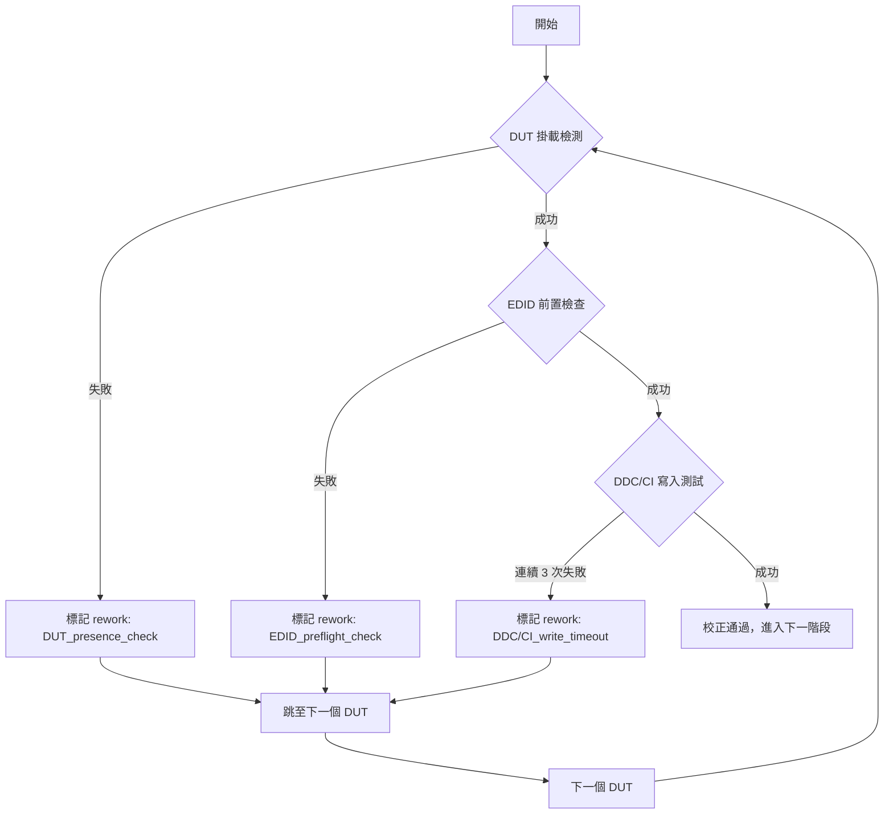

## 前置知識
在進入產線校正站的自動化流程前，必須先了解顯示器與主機之間的溝通基礎。DDC/CI（Display Data Channel Command Interface）是跑在 I2C 匯流排上的通訊協定，讓主機（PC 或嵌入式系統）讀寫顯示器的虛擬控制面板（VCP）功能。DDC/CI 顯示器的 I2C 位址固定是 0x6E／0x6F（8-bit 寫法，等於 7-bit 的 0x37；DDC/CI 1.1 p.13）。每個 VCP 功能都對應一個 feature 碼，例如亮度 0x10、對比 0x12、紅綠藍增益 0x16／0x18／0x1A（MCCS 2.2a p.26–27、p.34）。

EDID（Extended Display Identification Data）是顯示器透過 DDC 傳回給主機的識別資料，包含面板型號、支援的色域、timing 參數等資訊。EDID 結構包含 Base EDID（Block 0）與 CTA-861 擴充區塊（Block 1 起）。每個 128-byte block 的最後一個 byte（offset 127，0x7F）是 checksum：整個 block 的 128 個 byte 相加後，對 256 取餘數必須為 0。這不是 XOR，也和 IEEE 802.3 無關。checksum 錯誤時，主機通常會拒用或忽略該 block（實際行為依驅動而定）。

在自動化測試中，我們常用 `ddcutil` 這套 Linux 工具和螢幕溝通。它封裝了 DDC/CI 協定的低層細節，提供 `getvcp`、`setvcp`、`detect` 等指令。

## 技術核心
### DUT 掛載檢測邏輯
產線校正站的第一道關卡是確認 DUT（Device Under Test，即待測螢幕）有沒有正確連接、能不能通訊。若 I2C 不通或顯示器沒有回應 DDC/CI，後續的 EDID 讀取與校正步驟都做不了，只會浪費產線時間。

檢測流程：
1. 對指定的 bus 讀一個必定支援的 VCP（例如 `ddcutil --bus <n> getvcp 10 --brief`），看 exit code。
2. 不要只用 `ddcutil detect` 的 exit code 判斷：查 ddcutil 原始碼，`detect` 不論有沒有找到螢幕都回傳成功，找不到時印的是「No displays found.」（ddcutil src/app_ddcutil/main.c、src/ddc/ddc_display_ref_reports.c）。
3. HPD 是視訊介面（HDMI／DP）的訊號，不是 DDC/CI 的一部分。DDC/CI 1.1 只說顯示器偵測到拔線時要重置 DDC/CI 功能，主機應定期（例如每 3 秒）讀 ID 確認裝置還在（DDC/CI 1.1 §6.7.6，p.31）。治具若能量 HPD，可以當作輔助判斷。
4. 確認 i2c-dev 模組已載入：`lsmod | grep i2c_dev`（lsmod 顯示的模組名是底線）。

程式碼實作（參考 notes/2026-11-16-factory-calibration-station-dut-detection-edid-preflight-rework.md）：

```python
import subprocess
import time


def check_dut_presence(bus):
    """用 getvcp 0x10 確認指定 bus 上有可通訊的 DDC/CI 螢幕。"""
    try:
        result = subprocess.run(
            ["ddcutil", "--bus", str(bus), "getvcp", "10", "--brief"],
            capture_output=True, text=True, timeout=10,
        )
    except subprocess.TimeoutExpired:
        return False, {"bus": bus, "error": "ddcutil 逾時"}
    if result.returncode != 0:
        return False, {"bus": bus, "error": result.stderr.strip()}
    return True, {"bus": bus, "brief": result.stdout.strip()}
```

### EDID 讀取前置檢查
DUT 掛載檢測通過後，下一步是讀取 EDID 並驗證完整性。損壞或不完整的 EDID 會讓後續的色彩校正、輸入源切換等功能異常。

檢查清單：
- 長度：EDID 長度必須是 128 的倍數，而且等於 128 ×（1 + Block 0 offset 126 的擴充區塊數）。長度不足代表讀取中斷。
- 表頭：Block 0 前 8 個 byte 必須是 00 FF FF FF FF FF FF 00。
- checksum：每個 block 的 128 個 byte 加總 mod 256 = 0。
- 版本：Block 0 offset 18／19 是版本與修訂（例如 1.3、1.4），依產品規格比對。
- 擴充區塊內容：依產品規格檢查必要的 CTA-861 data block。例如 HDR 機種要有 HDR Static Metadata Data Block；HDMI 2.x 功能則看 HF-VSDB（HDMI Forum Vendor Specific Data Block）。兩者不同，不要混用（CTA-861 條文頁碼待查證）。

```python
EDID_HEADER = bytes([0x00, 0xFF, 0xFF, 0xFF, 0xFF, 0xFF, 0xFF, 0x00])


def edid_preflight(edid):
    """回傳錯誤清單；空清單代表通過。edid 為 bytes，例如讀自 /sys/class/drm/<connector>/edid。"""
    errors = []
    if len(edid) < 128 or len(edid) % 128 != 0:
        return ["長度不是 128 的倍數：%d" % len(edid)]
    if edid[0:8] != EDID_HEADER:
        errors.append("表頭錯誤")
    n_ext = edid[126]
    if len(edid) != 128 * (1 + n_ext):
        errors.append("擴充區塊數 %d 與長度 %d 不符" % (n_ext, len(edid)))
    for b in range(len(edid) // 128):
        if sum(edid[b * 128:(b + 1) * 128]) % 256 != 0:
            errors.append("block %d checksum 錯誤" % b)
    if edid[18] != 1 or edid[19] not in (3, 4):
        errors.append("EDID 版本 %d.%d 不在預期範圍" % (edid[18], edid[19]))
    return errors
```

常見錯誤與對策：
| 錯誤現象 | 可能原因 | 對策 |
|----------|----------|------|
| getvcp 失敗，找不到螢幕 | 線材沒插好、螢幕 DDC/CI 關閉、i2c-dev 未載入、電源不穩定 | 檢查連線與 OSD 的 DDC/CI 設定、載入 i2c-dev、確認電源序列 |
| EDID checksum 驗證失敗 | I2C 通訊雜訊、EEPROM 內容損壞、EDID 燒錄錯誤 | 重試讀取、檢查硬體連接，持續失敗就標記 rework |
| 讀到的 EDID 長度不對 | I2C 匯流排衝突、時序違規、電源還沒穩定就讀 | 依 DDC/CI 建議加等待與重試、檢查匯流排負載、電源穩定後再讀 |

### DDC/CI 寫入重試機制
DUT 掛載與 EDID 檢查通過後，接著寫 VCP，例如紅綠藍增益 0x16／0x18／0x1A 或亮度 0x10。注意 0x62 是喇叭音量（MCCS 2.2a p.29、p.90），不是白平衡增益。

時間規則要分清楚：DDC/CI 1.1 規定主機在命令之間至少等 40 ms（p.22、p.29），失敗時至少重試 3 次（p.25）。「超過 1 秒沒回應就算失敗」不是 MCCS 的規定，是應用層自訂的逾時。ddcutil 本身也會重試，而且 setvcp 預設會讀回驗證。

重試原則（設計值）：
- 最大重試次數：3 次
- 單次逾時：5 秒（含 ddcutil 內部重試，依實務經驗調整，不同晶片廠差異大）
- 間隔策略：指數退避，每次加倍（3 次嘗試之間等 0.1、0.2 秒）
- 連續 3 次寫入失敗，就標記為校正失敗，啟動自動 rework 流程，跳到下一個 DUT，並記錄完整錯誤日誌

程式碼實作（參考 notes/2026-11-16-factory-calibration-station-dut-detection-edid-preflight-rework.md）：

```python
def ddcutil_setvcp(feature_code, value, bus, retries=3, base_delay=0.1):
    """寫入 VCP feature，失敗或逾時都會重試。"""
    last_error = ""
    for attempt in range(1, retries + 1):
        try:
            result = subprocess.run(
                ["ddcutil", "--bus", str(bus), "setvcp",
                 "%02x" % feature_code, str(value)],
                capture_output=True, text=True, timeout=5,
            )
            if result.returncode == 0:
                return {"success": True, "value": value, "attempt": attempt}
            last_error = result.stderr.strip() or "exit %d" % result.returncode
        except subprocess.TimeoutExpired:
            last_error = "DDC/CI 寫入逾時"
        if attempt < retries:
            time.sleep(base_delay * (2 ** (attempt - 1)))
    return {"success": False, "error": last_error, "attempt": retries}
```

### 校正失敗自動 rework 流程
當 DUT 在預檢階段（DUT 掛載檢測或 EDID 前置檢查）失敗，或是 DDC/CI 寫入連續 3 次失敗時，要啟動自動 rework 流程，而不是直接報錯結束。

rework 流程：
1. 標記錯誤：記錄錯誤碼、DUT 編號、失敗步驟（DUT_presence_check／EDID_preflight_check／DDC/CI_write_timeout 等）
2. 跳過處理：跳過目前的 DUT，避免卡住整條產線
3. 記錄日誌：把檢查結果、重試次數、錯誤訊息寫入產線資料庫，支援 Cpk 監控與追溯
4. 繼續下一個 DUT：移到下一個待測單元，繼續自動化流程

流程圖說明：


## 真實血淚案例
> 情境模擬（依 VESA E-EDID、DDC/CI 規格與 ddcutil 實務經驗推演），非真實客戶或產品事件。以下數字是示意。

### 案例：產線上 DUT 掛載檢測間歇性失敗

背景：
在一條每分鐘處理 1 個 DUT 的產線上，工程師發現偶爾會有 DUT 檢測失敗，整條產線卡住，要人工重啟。

現象描述：
- 當天約 5% 的 DUT 檢測失敗；腳本只看 `ddcutil detect` 的輸出字串，判斷邏輯不可靠
- 失敗是間歇發生的，有時重試一次就過，有時要重啟整個校正站
- 少數情況下，治具量到 HPD 在檢測期間出現短脈衝

根因分析（依公開規格推演）：
1. 螢幕在拔插或重置期間：DDC/CI 1.1 規定顯示器偵測到拔線時會重置 DDC/CI 功能（§6.7.6，p.31）。HPD 抖動期間去讀，螢幕可能還沒準備好。
2. 多個 DUT 共用一條 I2C：每台螢幕的 DDC/CI 位址都是 0x6E／0x6F（p.13），同一條匯流排接多台一定會撞位址，負載也會讓波形變差。
3. 電源序列：電源還沒穩定就讀，會讀不到或讀到錯的值。等待時間要看 panel 與 scaler 的 datasheet（待查證）。

解決方案：
1. 檢測前先確認 HPD（若治具能量）穩定一段時間，再開始 DDC/CI 探測；穩定時間是設計值，要實測。
2. 每個 DUT 配一條獨立的 I2C 匯流排。
3. 開機後加入電源穩定等待，再用 getvcp 檢測，並依 DDC/CI 建議重試。

改善結果（示意）：
- DUT 檢測失敗率從 5% 降到 0.5%
- 不再需要人工重啟

## 新人避坑指南
1. 看懂關鍵 VCP 與訊號線：
   - VCP 0x10：亮度（Luminance）。最大值由螢幕回報，不一定是 255；用 `getvcp 10` 看 current 與 max（MCCS 2.2a p.23、p.26）。
   - VCP 0x16／0x18／0x1A：紅綠藍增益（MCCS 2.2a p.34）；0x62 是喇叭音量，不要寫錯。
   - HPD 訊號：屬於 HDMI／DP 介面，判斷的是電位高低與持續時間；電阻值依介面規格與電路設計（待查證）。
   - DDC/CI 位址：0x37（7-bit），也就是 0x6E 寫／0x6F 讀（8-bit；DDC/CI 1.1 p.13）。

2. 未來寫 Code 或驗證如何避免重蹈覆轍：
   - 不要用 `ddcutil detect` 的 exit code 判斷有沒有螢幕
   - 所有的 DDC/CI 讀寫都要設合理的 timeout，避免程式卡住
   - 重試要搭配退避，避免匯流排忙碌時造成更多衝突
   - EDID checksum 一定要驗證，失敗就不要直接使用，重試或標記 rework
   - 產線一定要有 rework 流程，避免單一 DUT 卡住整條線

## 思考題
問題：在產線自動化測試中，用 `ddcutil getvcp 0x10` 讀亮度，回傳 current value = 255，這代表什麼？可能的原因有哪些？

<details>
<summary>點此展開答案</summary>

參考答案：
MCCS 的 10h（Luminance）是連續型 VCP，顯示器會同時回報目前值與最大值（MCCS 2.2a p.23、p.26）。所以要先看 max：

1. max 也是 255、current 是 255：亮度已調到最大，合理。
2. max 是 100、current 卻是 255：超出範圍，可能是通訊錯誤或韌體 bug。DDC/CI 回覆有 checksum，ddcutil 會檢查；仍然出現就要查螢幕韌體。
3. 部分螢幕韌體在不支援或出錯時回傳固定值（待查證，依機種）。
4. 螢幕 OSD 關閉 DDC/CI 時，通常是讀取失敗，而不是讀到 255（實際行為依機種，待查證）。

實務對策：
- 讀取前先確認 DUT 掛載檢測通過
- 一律用 current 與 max 比對，超出 max 才視為異常
- 異常時重試 3 次，再懷疑硬體問題

</details>

## 參考資料
1. ddcutil Documentation － https://www.ddcutil.com/ （getvcp／setvcp／detect 使用說明）
2. ddcutil 原始碼 － https://github.com/rockowitz/ddcutil （detect 一律回傳成功：src/app_ddcutil/main.c；「No displays found.」：src/ddc/ddc_display_ref_reports.c）
3. VESA DDC/CI Standard Version 1.1 公開鏡像（位址 0x6E／0x6F p.13；40 ms 等待 p.22、p.29；重試 p.25；Hot Plugging §6.7.6 p.31）
4. VESA MCCS 2.2a 公開鏡像 － https://milek7.pl/ddcbacklight/mccs.pdf （10h p.23、p.26；16h／18h／1Ah p.27、p.34；62h p.29、p.90；頁碼為 PDF 頁序）
5. VESA Enhanced EDID（E-EDID）Standard Release A, Revision 2 － EDID 結構與 checksum（條文頁碼待查證）
6. EdidCraft － EDID Format Guide － https://edidcraft.com/learn.html （EDID 1.x／DisplayID 2.x 結構解析、CTA-861 extension）
7. CTA-861-G/H － HDR Static Metadata Data Block 與 HF-VSDB 定義（條文頁碼待查證）

---
*本文依 rules/ARTICLE-SPEC.md 與 rules/glossary.tsv 撰寫，台灣用語、全形標點、直白有人味為原則。數字與協定行為已盡力對照公開規格來源，未能查證之處標示（待查證），讀者請依實際手頭文件與晶片規格作為最終依據。*
